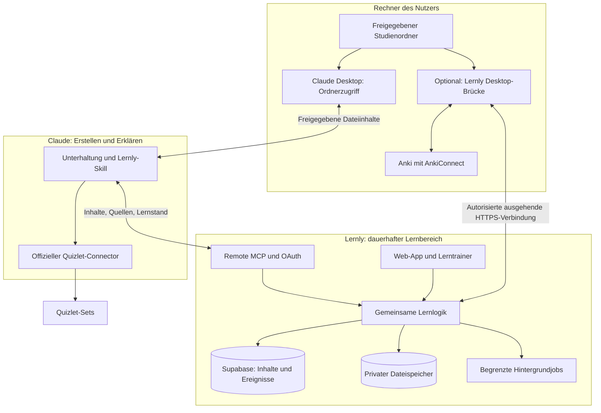
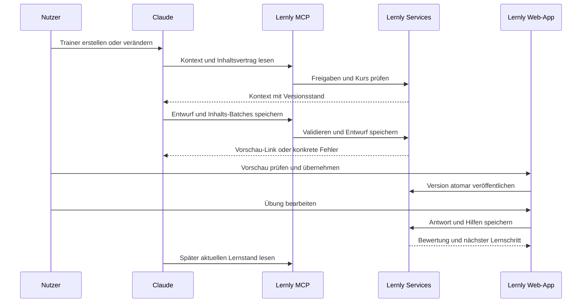

# Lernly: Architektur, Integrationen und Wirtschaftlichkeit

Stand: 13. November 2026. Entscheidungs- und Umsetzungsplan nach Daniels zweiter Konkretisierung. Dieser Entwurf ersetzt die Produkt- und Architekturentscheidungen des [ersten Plans](/Users/rdb/lernly/docs/strategy/2026-11-13-lernly-claude-pivot.md). Grundlage sind der lokale Code, das zuvor betrachtete [CF Study OS](https://claude.ai/artifact/EbKXQ41UYHRo5aZPAzZEDF) und aktuelle Primärquellen. Es wurden keine Produktionskonten, Rechnungen oder echten Integrationsdurchläufe geprüft. Die folgenden Schnittstellen und Tabellen sind Vorschläge, keine bereits gebauten Funktionen. Beträge und Termine sind ausdrücklich gekennzeichnete Szenarien bzw. Schätzungen.

**1. Entscheidung: Claude erstellt; Lernly ist der Ort zum Lernen.**

Die erste Produktversion soll Marketing, Mathematik/Statistik und Finance als unterschiedliche Lernformen unterstützen. Die Positionierung ist zunächst BWL-Studium; sie beschränkt sich nicht auf Finance, IB, PE oder Consulting. Technisch werden Fächer durch gemeinsame Lernbausteine und fachliche Anweisungen abgebildet. Die erste Qualitätsprüfung umfasst drei konkrete Kurse statt eines unbelegten Versprechens, jedes Fach gleich gut zu beherrschen.

Der Nutzer verbindet Lernly mit Claude, gibt ausgewählte Unterlagen frei und beschreibt seine Lernwünsche. Claude entwickelt mit ihm den Lerntrainer. Über Lernlys Connector werden die Inhalte in Lernly gespeichert. Dort funktionieren Erklärung, Karten, Aufgaben, Musterlösungen, Lernplan und Fortschritt auch ohne laufende Claude-Unterhaltung. Für neue Inhalte und individuelle Rückfragen kehrt er zu Claude zurück. Optional kann eine Lernly-Ansicht später zusätzlich innerhalb von Claude geöffnet werden.

Das verkaufte Ergebnis lautet: „Aus deinen Unterlagen wird dein persönlicher Klausurtrainer – mit Übungen, Wiederholungen und einem Lernplan, der zu deinem Stand passt.“ Der Connector ist ein Zugang, nicht allein das Produkt. Ein zusätzliches Abo muss durch wiederholten Lernnutzen gerechtfertigt werden; ein guter Prompt und gespeicherte Inhalte allein reichen dafür nicht sicher aus.

| Entscheidung | Erste Version | Späterer Ausbau |
|---|---|---|
| Hauptoberfläche | Lernly-Web-App, auf dem Handy nutzbar | Lernly-MCP-App zusätzlich in Claude |
| Erstellen und individuelles Erklären | Eigener Claude-Zugang des Nutzers | Wahlweise separat kalkulierte Lernly-API-Funktion |
| Gespeicherter Trainer | Versionierte Inhalte mit interaktiven Lernly-Komponenten | Separat isolierte freie Visualisierungen |
| Lokale Unterlagen | Verbundener Ordner über Claude Desktop; reale Dateigrenzen testen | Optionale lokale Lernly-Komponente für Indexierung großer Bestände |
| Quizlet | Offiziellen Quizlet-Connector in derselben Claude-Unterhaltung verwenden | Direkter Lernly-Zugriff nur mit dokumentierter Berechtigung und passender API |
| Anki | Export als verlässlicher Basisweg; bestehende lokale Anbindung im Pilot prüfen | Direkte Erstellung und Review-Abgleich über lokale Lernly-Brücke und AnkiConnect |
| Hochschulen | Bestehenden Bereich erhalten; kein gemeinsamer Produktlaunch | Eigene institutionelle Zugriffs-, Betriebs- und Vertragsentscheidung |

**2. Was „das Artifact in Lernly“ konkret bedeutet.**

Ein von Claude erstellter interaktiver Trainer kann technisch in Lernly laufen. Dazu muss sein Inhalt oder portabler Code bei Lernly ankommen und dort eine passende Laufzeit haben. Das ist etwas anderes als die gehostete Claude-Artifact-Umgebung mitsamt deren Anmeldung, Speicherung und KI-Zugriff unverändert einzubetten. Anthropic dokumentiert Exporte, aber daraus folgt keine portable Claude-Abrechnung für eine fremde Website. [Artifact-Exporte](https://support.claude.com/en/articles/17153992-what-are-artifacts-and-how-do-i-use-them)

Für den Kern wählen wir deshalb einen **offenen Inhaltsvertrag**: Claude liefert Erklärungen, Beispiele, Quellen, Karten und Aufgaben als strukturierte Daten. Lernly stellt die Oberfläche dar. Die Inhalte bleiben persönlich: Sprache, ausführliche Analogien, alternative Erklärungen, Lernreihenfolge, Schwierigkeitsgrad, LaTeX und konkrete Vorlesungsnotation sind variabel. Der Vertrag begrenzt ausführbaren Code und Datenformate, nicht die Tiefe einer Erklärung.

Möglicher Nutzerablauf:

1. In Lernly „Marketing“ anlegen, Klausurdatum und bevorzugten Lernstil wählen.
2. Claude mit Lernly verbinden und den Vorlesungsordner freigeben.
3. „Erstelle mir aus diesen Folien einen Trainer mit kurzen Erklärungen, Beispielen und prüfungsnahen Karten. Stelle Verständnisfragen, bevor du alles fertigstellst.“
4. Claude liest passende Quellen und den Lernly-Inhaltsvertrag, legt einen Entwurf an und ergänzt ihn abschnittsweise.
5. Lernly prüft Struktur, Quellenverweise und unterstützte Aufgabentypen. Claude erhält konkrete Fehler zur Korrektur.
6. Der Nutzer sieht eine Vorschau und übernimmt die Version. Ein Link öffnet den fertigen Trainer in Lernly.
7. Lernen, Wiederholen und bekannte Rechenvarianten laufen dort ohne neue Modellaufrufe. Eine neue Claude-Sitzung kann denselben Lernstand abrufen und den Trainer verbessern.

Das vorhandene CF Study OS ist eine Qualitätsreferenz für diesen Ablauf. Seine vollständige automatische Übernahme und die Richtigkeit aller Aufgaben wurden nicht nachgewiesen. Bereits bestehende Artifacts benötigen einen eigenen Import-/Konvertierungsschritt; der Link allein ist kein allgemeiner Zugriff auf den Quellcode oder private Ausgangsmaterialien.

Für frei programmierte Spezialsimulationen ist später ein zweiter Kanal möglich: statisches HTML/JavaScript auf einer getrennten, cookielosen Origin, restriktive Sandbox und CSP, keine Kontotokens und kein beliebiger Netzwerkzugriff. Eine kleine Nachrichtenbrücke akzeptiert nur definierte Ereignisse und prüft Absender, Sitzung und Schema. Solcher Code darf weder Prüfwerte noch Kontoberechtigungen autoritativ setzen. Diese zusätzliche Laufzeit ist kein Bestandteil des ersten Piloten.

Claude-Abos sind keine API-Guthaben für unser Backend. Ohne gesonderte Freigabe dürfen Drittprodukte nicht einfach claude.ai-Anmeldung oder deren Nutzungslimits als eigene Agenten-Infrastruktur anbieten. Innerhalb von Claude verwendet der Nutzer seine dort verfügbaren Funktionen und Limits; Modellaufrufe aus Lernly benötigen eine eigene zulässige API-Abrechnung. [Anthropic: Agent-SDK-Authentifizierung](https://code.claude.com/docs/en/agent-sdk/quickstart)

Eine MCP App zeigt umgekehrt unsere Oberfläche **in Claude**. Sie kann später den Wechsel zwischen Unterhaltung und Trainer verkürzen. Vollständiges Einbetten einer Website hat zusätzliche Freischaltungs- und Origin-Regeln; deshalb bleibt der normale Lernly-Link ein unabhängiger Zugang. [MCP Apps](https://claude.com/docs/connectors/building/mcp-apps/getting-started), [Website-Einbettung](https://claude.com/docs/connectors/building/mcp-apps/embedded-sites)

**3. Gesamtarchitektur und Verantwortlichkeiten.**



Die lokale Brücke ist optional und wird stufenweise ergänzt. Die Verbindung zu Quizlet läuft zunächst über Claude; das Diagramm behauptet keinen verfügbaren Quizlet-Fortschrittskanal nach Lernly.

| Baustein | Verantwortung | Nicht seine Aufgabe |
|---|---|---|
| Lernly-Skill | Fachliche Arbeitsweise, Quellenpflicht, Lernpräferenzen, Wahl der Werkzeuge | Sicherheitsregeln ersetzen oder korrekte Antworten garantieren |
| MCP-Adapter | Kleine, typisierte Aktionen für Claude; gültige Identität und Rechte prüfen | Generischer SQL-Zugriff, Ausführen beliebiger Programme |
| Gemeinsame Lernlogik | Inhaltsversionen, Bewertung, Planung, Export, Berechtigungen | An Next.js-Cookies oder eine bestimmte KI-Oberfläche gebunden sein |
| Web-Laufzeit | Lernen, lokale Eingaben, Feedback, Fortschrittsanzeige | Bei jeder Übung einen neuen Modellaufruf benötigen |
| Supabase | Identität, relationale Daten, private Assets, Jobs | Unbegrenzt Originalordner spiegeln |
| Lokale Brücke | Auswahl und Indexierung lokaler Quellen, Anki-Anbindung | Claude-Konto automatisieren oder dessen Abo als Backend missbrauchen |

Deployment zunächst: vorhandenes Next.js auf Vercel, Supabase Auth/Postgres/Storage und ein schlanker Node-Route-Handler für Remote MCP. Kein zusätzlicher Microservice nur für MCP. Lange Extraktion wird lokal oder in einem getrennten Worker ausgeführt, nicht innerhalb eines offen gehaltenen HTTP-Aufrufs. Der Pilot benötigt keine eigene Cloud-OCR-Flotte.

**4. Fächer werden über Lernhandlungen unterstützt.**

| Fachgruppe | Geeignete Bausteine | Qualitätsprüfung |
|---|---|---|
| Marketing, Management | Begriffe abrufen, Zusammenhänge erklären, Frameworks anwenden, kurze Fälle, MC-Fragen | Präzise Karten; Fälle prüfen Anwendung, nicht nur Wiedererkennung |
| Mathematik, Statistik | Musterlösungen, Zwischenschritte, Zahlenvarianten, Formeln, Einheiten, Fehlerdiagnose | Zulässige Parameter, korrekte Lösungen, Toleranzen und Grenzfälle |
| Finance, Accounting | Rechenaufgaben plus Begriffsverständnis und Interpretation | Rechenweg und Annahmen stimmen; Konventionen des Kurses erhalten |

Ein Fachprofil steuert die Mischung, beispielsweise mehr offene Anwendung bei Marketing und mehr neue Rechenvarianten bei Mathematik. Die Auswahl bleibt anpassbar. Nicht jede Marketingfolie wird automatisch eine Karte, und Mathematik wird nicht auf Definitionskarten reduziert.

Kernformat `LearningDocumentV1`:

- Metadaten: `schemaVersion`, `examId`, `revision`, `language`, `subjectProfile`, Lernpräferenzen, Ersteller-/Skill-Version.
- Themen: stabile IDs, Lernziele, Voraussetzungen, belegte Klausurrelevanz und Quellen.
- Erklärungen: Markdown, sichere LaTeX-Darstellung, Beispiele, typische Fehler, Tabellen und erlaubte Visualisierungsdaten.
- Lernobjekte: `flashcard`, `multiple_choice`, `short_answer`, `numeric`, `worked_example`, `case`.
- Numerische Vorlage: registrierter `generatorId`, `generatorVersion`, erlaubte Parameter und Bewertungsregeln; kein vom Modell gelieferter Servercode.
- Darstellung: Reihenfolge, sichtbare Module, Erklärungstiefe und Varianten; Darstellung und fachlicher Inhalt bleiben getrennt.
- Herkunft: `sourceVersionId`, PDF-Seite, optional Foliennummer/Abschnitt, Ausschnitt-Hash, Status der Quellenprüfung.

Die kanonischen Objekte bekommen dauerhafte IDs. Der Server vergibt sie oder bildet stabile Client-Schlüssel einmalig darauf ab. Ein neues Dokument darf bereits beantwortete Aufgaben nicht durch eine komplette Neugenerierung ihrer Identitäten verlieren lassen.

Numerische Übungen werden nach Möglichkeit deterministisch geprüft: Parameter ziehen, Lösung und Zwischenschritte berechnen, Eingaben normalisieren und Toleranzen anwenden. Prozent/Dezimalzahl, deutsche Dezimalkommas, Einheiten und Rundung sind Teil des Vertrags. Freie algebraische Umformungen brauchen eine eigene geprüfte Gleichheitsprüfung; bis dahin werden nur unterstützte Antwortformen bewertet. Offene Begründungen erhalten Rubriken und Selbstabgleich oder eine ausdrücklich als KI-Einschätzung markierte Bewertung in Claude.

So entsteht „Üben, üben, üben“ ohne laufende Generierungskosten für bekannte Aufgabentypen. Neue Aufgabentypen oder freie individuelle Erklärungen bleiben KI-Arbeit. Gute Karten und Zahlenvarianten allein beweisen außerdem noch keinen Lernerfolg: Der Pilot prüft auch neue Aufgaben, die nicht zuvor als Beispiel gezeigt wurden.

**5. Datenmodell: neue Lernobjekte neben bestehenden Paketen.**

`exams` bleibt zunächst der persönliche Kurs-/Klausurcontainer, auch ohne Klausurdatum. Eine zusätzliche allgemeine Kursplattform ist für diesen Umbau nicht erforderlich. Alle persönlichen Tabellen sind nutzergebunden; Beziehungen müssen auch innerhalb desselben Eigentümers liegen.

| Tabelle / Gruppe | Wesentliche Felder und Regeln | Einführung |
|---|---|---|
| `exam_learning_settings` | `exam_id`, Nutzer, Fachprofil, Sprache, Zeitbudget, Darstellungswünsche | Pilot |
| `source_assets`, `source_versions` | Kurs, Provider, Dateiverweis, Hash, Seitanzahl, Versionsnummer, Verfügbarkeits-/Verarbeitungsstatus; Originalpfad bleibt lokal | Pilot mit Metadaten; Verarbeitung ausbauen |
| `source_sections` | Quellversion, Seitenbereich, Abschnitt, Extraktionsstatus, optional freigegebener Text/Asset-Verweis | Große-Dateien-Stufe |
| `learning_topics` | Kurs, stabile ID, Eltern-/Voraussetzungsbezug, Gewichtung mit Herkunft | Pilot |
| `learning_objects`, `learning_object_versions` | Stabile Objekt-ID; unveränderliche Version mit Typ, Inhalt, Quellen und Validierungsstatus | Pilot |
| `trainer_drafts`, `trainer_versions` | Kurs, Basisrevision, geordnete Objektversionen, Layout, Validierungsbericht, Veröffentlichungsstatus | Pilot |
| `study_sessions`, `learning_events` | Nutzer, Objektversion, Sitzung, Variante, Antwort, Hilfen, Bewertung, Ursprung, Zeitpunkt und Idempotenzschlüssel | Pilot |
| `topic_mastery` | Neu berechenbare Zusammenfassung aus Ereignissen mit Algorithmusversion, Evidenz und Aktualisierungszeit | Beta; anfangs aus Ereignissen ableiten |
| `connector_grants` | Nutzer, OAuth-Client, erlaubte Kurse/Aktionen, Widerruf und Ablauf | Vor externer Verbindung |
| `external_deck_links` | Provider, externe ID/URL, Kurs, Mappingstatus, zuletzt bestätigte Version | Pilot für Verweise |
| `external_item_mappings`, `sync_cursors` | Lernobjekt ↔ externe Notiz/Karte; letzter übernommener Review, Konfliktstatus | Anki-Sync |
| `devices`, `device_jobs` | Gekoppeltes Gerät, begrenzte Rechte, Heartbeat, auslaufender Job-Lease, Ergebnis | Lokale Brücke |
| `processing_jobs`, `usage_events` | Zustand, Versuche, Idempotenz, Ressourcenmenge/Kostenkategorie; keine kompletten Folien in Logs | Verarbeitung/Beta |

Im Pilot sind dies logische Grenzen: Kleine Einstellungen dürfen zunächst JSONB sein. Quellenverweise können in unveränderlichen Objektversionen liegen. Nicht jede Zeile dieser Tabelle verlangt sofort einen eigenen Dienst oder eine komplexe UI. Langlebige IDs, Besitzprüfung und unveränderliche bewertete Versionen sind dagegen von Beginn an nötig.

Ereignisse sind append-only. Korrekturen erzeugen neue Ereignisse oder Versionen. Eindeutigkeit mindestens über Nutzer, Ursprung und externe Ereignis-ID; bei Web-Versuchen zusätzlich ein vom Client wiederverwendeter Request-Schlüssel. Derselbe Versuch zählt nach einem Retry nicht doppelt. Zeitstempel umfassen `occurredAt` und `receivedAt`, damit verspätete Offline-Ereignisse sinnvoll eingeordnet werden.

**6. API und MCP: eine Fachlogik für beide Oberflächen.**

Zieladresse im Entwurf: `https://lernly-app.de/api/mcp`. Vor Veröffentlichung zunächst eigene Testumgebung. Streamable HTTP, stateless Requests und kurz laufende Werkzeuge. Große Ergebnisse werden paginiert, lange Arbeit liefert eine Job-ID. Claude dokumentiert derzeit etwa 150.000 Zeichen pro Tool-Ergebnis und 240 Sekunden pro Aufruf; unsere üblichen Antworten sollen deutlich darunter liegen. MCP-Sampling und Resource-Abonnements sind keine Grundlage des Produkts, weil Claude sie hier nicht unterstützt. [MCP-Server für Claude](https://claude.com/docs/connectors/building)

| Werkzeug | Zweck / Ergebnis | Schreibrecht |
|---|---|---|
| `list_study_spaces` | Freigegebene Kurse und aktuelle Trainer-Versionen | Nein |
| `get_learning_context` | Ziele, Präferenzen, Inhaltsvertrag, Fortschritt, freigegebene Quellenübersicht | Nein |
| `search_sources` | Begrenzte Treffer mit Seitenbezug und Verfügbarkeitsstatus | Nein |
| `read_source_section` | Bestimmter freigegebener Ausschnitt; bei lokalem Offline-Gerät explizit nicht verfügbar | Nein |
| `register_sources` | Manifest mit Quellen, Versionen und überprüfbarem Herkunftsstatus registrieren | Quellen-Metadaten |
| `begin_trainer_draft` | Entwurf auf einer bekannten Revision eröffnen | Entwurf |
| `upsert_learning_objects` | Kleine Batches von Inhalten und Quellen; Fehler pro Objekt zurückgeben | Entwurf |
| `validate_trainer_draft` | Struktur, Referenzen, unterstützte Generatoren und Abdeckung prüfen | Validierungsstatus |
| `commit_trainer_draft` | Konsistente Version atomar übernehmen; Nutzer hat vorher Vorschau/Übernahme gewählt | Veröffentlichung im eigenen Konto |
| `get_study_plan` | Nächste sinnvolle Aufgaben aus vorhandenem Lernstand | Nein |
| `record_study_event` | Begrenztes Ereignis zur passenden Sitzung; Prüfung/Einordnung durch Lernly | Fortschritt |
| `create_card_export` | Anki-/Quizlet-Datei oder Importtext erstellen | Eigenes Export-Asset |
| `attach_external_deck` | Externes Deck zuordnen, Rechte und Provider prüfen | Deck-Verweis |
| `request_anki_sync` | Begrenzten Job für ein gekoppeltes Gerät anlegen | Erst mit lokaler Brücke |
| `get_job_status` | Verarbeitung/Synchronisierung nachvollziehen | Nein |

Werkzeuge sind nach Rechteklassen freigegeben; die App blendet nicht verfügbare Integrationen aus. Ein reiner Export darf keine angeblich bestehende Synchronisierung anzeigen. `search_sources` bietet im ersten Pilot nur registrierte/freigegebene Inhalte an; lokale Originale liest Claude über seinen Desktop-Zugang. Das Remote-Tool darf keinen lokalen Zugriff vortäuschen.

Die interne Web-API umfasst entsprechend Kurskontext, Entwürfe, Trainer-Versionen, Sitzungen/Ereignisse, Exporte und Gerätejobs. Vorhandene Server Actions werden dünne Adapter über dieselben Services. Fachliche Regeln werden nicht separat in MCP und Web implementiert.

Fehlercodes unter anderem: `NOT_AUTHORIZED`, `SOURCE_OFFLINE`, `STALE_SOURCE`, `REVISION_CONFLICT`, `INVALID_CONTENT`, `UNSUPPORTED_EXERCISE`, `BUDGET_EXCEEDED`, `DEVICE_OFFLINE`. Jede Antwort beschreibt, ob Wiederholen sinnvoll ist und welche Eingabe korrigiert werden muss. Änderungen verlangen Basisrevision und Idempotenzschlüssel. Neue Quellen invalidieren betroffene Ableitungen, nicht den gesamten Lernstand.



Die Übernahme ist ein Produktablauf für erzeugte Änderungen, keine Pflicht, bei jedem Kartenklick eine Bestätigung einzuholen. Ein Freigabemodus für kleine spätere Entwurfsänderungen kann nach dem Pilot vereinfacht werden. Die erste sichere technische Abnahme verwendet die Web-Vorschau.

**7. Anmeldung und Datenzugriff.**

Supabase Auth bleibt die Anmeldung. Zuerst dessen OAuth-2.1-Server für Claude testen: Discovery, PKCE, Zustimmungsseite, Access-/Refresh-Tokens und Widerruf. OAuth-Clients nutzen bestehende Nutzeridentitäten; die konkrete Aktivierung und SDK-Kompatibilität im Projekt sind noch zu prüfen. [Supabase MCP Auth](https://supabase.com/docs/guides/auth/oauth-server/mcp-authentication)

Die Zustimmung gilt für ausgewählte Kurse und Aktionen. Eigene Lernly-Rechte wie `content:write` sind zunächst Anwendungsberechtigungen in `connector_grants`, keine Behauptung, beliebige benutzerdefinierte Supabase-OAuth-Scopes seien vorhanden. Supabase dokumentiert Standard-OIDC-Scopes; Kurs- und Aktionsrechte müssen wir selbst zuverlässig durchsetzen. [OAuth-Server](https://supabase.com/docs/guides/auth/oauth-server)

Tokenprüfung umfasst Signatur/JWKS, Aussteller, Zielressource/Audience gemäß gewählter Konfiguration, Ablauf, Client und aktive Freigabe. Nutzer-IDs kommen aus dieser Identität. Browser-Cookies ersetzen diese Prüfung nicht. RLS muss zusätzlich OAuth-Clients, Kursfreigaben und alte Tabellen absichern; neue enge Policies allein helfen nicht, wenn daneben breite permissive Policies weiter Zugriff erlauben. Besonders `user_secrets`, Billing-Daten, alte RPCs und Storage-Zugriff dürfen nicht pauschal erreichbar werden. [Client-bezogene RLS](https://supabase.com/docs/guides/auth/oauth-server/token-security)

Der MCP-Pfad arbeitet grundsätzlich im Nutzerkontext. Privilegierte Worker-Zugriffe bleiben auf erlaubte Jobs begrenzt. Weder Claude noch ein Artifact bekommt Service-Role-Schlüssel. Kurzlebige Download-URLs gelten für einen konkreten privaten Export, nicht für beliebige Storage-Pfade. Widerruf sperrt weitere Aufrufe; schon übertragene Inhalte lassen sich dadurch nicht rückwirkend aus anderen Diensten entfernen.

Quelltexte sind nicht vertrauenswürdige Anweisungen. Ein Satz in einer PDF kann weder Rechte erweitern noch zusätzliche Ordner freigeben. Inhalte werden sanitisiert, Tool-Argumente validiert und freie URLs nicht ungeprüft vom Server abgerufen. Lesezugriff auf Vorlesungen und Schreibzugriff auf die private Lernsammlung sind getrennte Rechte.

**8. Ordnerzugriff ohne ständiges Hochladen.**

Der gewünschte Ablauf ist realistisch. Er verlangt aber eine lokale Komponente oder einen bereits verbundenen Cloudspeicher: Ein Remote-MCP-Server kann nicht einfach `/Users/...` auf dem Rechner öffnen. Claude verbindet Remote-Connectoren aus seiner Cloud. [Remote-MCP-Zugriff](https://support.claude.com/en/articles/11175166-get-started-with-custom-connectors-using-remote-mcp)

**Stufe A: vorhandenen Claude-Desktop-Zugriff nutzen.** Der Nutzer gibt seinen Studienordner frei. Claude kann daraus lesen; Lernly erhält zunächst Lerninhalte, Quellenmetadaten und bei Bedarf ausdrücklich freigegebene Ausschnitte. Das vermeidet eine eigene Installationspflicht für den ersten Test. Die derzeitige Cowork-Architektur vermittelt lokalen Dateizugriff über die laufende Desktop-App; ohne erreichbaren Rechner fehlen lokale Quellen. Geöffnete Inhalte werden bei Anthropic verarbeitet. „Kein manuelles Hochladen“ beschreibt die Bedienung, nicht eine Garantie lokaler Datenverarbeitung. [Cowork-Architektur](https://support.claude.com/en/articles/14479288-claude-cowork-architecture-overview)

Dieser native Zugriff beweist noch nicht, dass jede mehrgigabytegroße Datei schnell oder vollständig verarbeitet wird. Der Pilot testet die tatsächlich benutzte Claude-Version, den Tarif und die Originalunterlagen. Lernlys Kern funktioniert auch dann weiter, wenn Claude gerade keine neuen Dateien lesen kann.

**Stufe B: optionale Lernly Desktop-Brücke.** Kleine installierbare Anwendung mit Ordnerauswahl, Indexierungsstatus und Anki-Verbindung. Ein isolierter lokaler Worker liest Dateien seitenweise, führt einen Index und hält Originalpfade und vollständige Originaldateien lokal. Ein lokaler MCP-Adapter kann geeignete Claude-Clients bedienen; wir setzen dessen Verfügbarkeit in jeder Cloud-Cowork-Konfiguration nicht voraus.

Der von Lernly kontrollierte Zugang läuft unabhängig davon über ein gekoppeltes Gerät: Systembrowser-Anmeldung, kurzlebige Geräteberechtigung, sichere Ablage des Refresh-Tokens im Betriebssystem, ausgehendes HTTPS. Das Gerät holt begrenzte Jobs aus Lernly ab und sendet nur autorisierte Ergebnisse. Keine eingehenden Ports, kein veröffentlichter Anki-Port und kein generischer Fernzugriff auf den Rechner. Für längere Quellabfragen liefert MCP zunächst eine Job-ID. Ein Job kann nur innerhalb zuvor lokal freigegebener Ordner und Aktionen arbeiten.

Originaldateien bleiben standardmäßig lokal. Optional speichert Lernly freigegebenen extrahierten Text und ausgewählte Abbildungen, damit mobile Geräte und spätere Chats auch bei ausgeschaltetem Rechner darauf zugreifen können. Dieser Modus hat sichtbare Speicher- und Verarbeitungskosten. Ohne ihn bleiben fertige Trainer mobil verfügbar, zusätzliche Originalseiten aber möglicherweise offline. Ein reines Inhaltsmanifest ohne Text reicht nicht für serverseitige Volltextsuche.

**Stufe C: Cloudordner bei nachgewiesenem Bedarf.** Drive/OneDrive können über die jeweiligen Nutzerberechtigungen angebunden werden. Das ist ein weiterer Quellenadapter mit denselben Versions- und Abdeckungsregeln. Nicht gleichzeitig mit der lokalen Brücke mehrere Sync-Systeme entwickeln.

Browser-Ordnerauswahl bleibt ein Import-Fallback. Die File-System-Access-API hat eingeschränkte Browserunterstützung; sie ist keine zuverlässige allgemeine Lösung für Hintergrundüberwachung auf allen Geräten. [MDN: showDirectoryPicker](https://developer.mozilla.org/en-US/docs/Web/API/Window/showDirectoryPicker)

**9. Große PDFs: indexieren, auswählen, vollständig nachvollziehen.**

500 Folien und mehrere Gigabyte sind unterschiedliche Belastungen. Eine kleine Datei kann sehr viel Text enthalten; eine riesige Datei kann überwiegend hochauflösende Bilder enthalten. Ein größerer Upload-Schalter löst weder Speicherbedarf noch Kontextverbrauch oder Qualität.

Geplante Verarbeitung:

1. Freigegebene Dateien inventarisieren: Format, Bytes, Seitanzahl, Änderung, stabiler Hash; Duplikate erkennen.
2. Nach Seiten/Abschnitten extrahieren, Seitenidentität erhalten; Diagramme und Formeln bei Bedarf als begrenzte Bildausschnitte erfassen.
3. Scans erkennen; OCR nur für benötigte Seiten. Verschlüsselte oder beschädigte Dateien mit konkretem Status ausweisen.
4. Inhaltsverzeichnis, Abschnittstitel und Suchindex erzeugen. Zunächst lokale/Volltextsuche; semantische Suche nur ergänzen, wenn der Retrieval-Test einen Bedarf zeigt.
5. Claude zunächst Gliederung, relevante Ausschnitte und passende Bilder geben; nicht bei jeder Frage das gesamte Semester erneut übertragen.
6. Eine Abdeckungsliste führen: erkannt, extrahiert, für Lernziele geprüft, bewusst ausgeschlossen, noch offen. Suchtreffer allein beweisen keine vollständige Kursabdeckung.
7. Nur geänderte Versionen neu verarbeiten. Abgeleitete Inhalte auf betroffene Quellen zurückführen und bei Änderungen als prüfbedürftig markieren.

API-PDF-Grenzen sind modell- und kontextabhängig. Die aktuelle Dokumentation nennt 32 MB Request-Größe je nach Plattform und 600 Seiten bei 1M-Kontext, sonst 100; dichter Inhalt kann früher an Grenzen stoßen. Das sind keine pauschalen Limits für jeden Claude-Desktop-Dateizugriff. Unser Code enthält derzeit eigene 100-Seiten-Vision-Grenzen. [Claude PDF-Verarbeitung](https://platform.claude.com/docs/en/build-with-claude/pdf-support)

Verarbeitungsjobs sind resumierbar, abbrechbar und pro Nutzer begrenzt. Schlüssel: Datei-Hash plus Extraktorversion plus Einstellungen. Speicher und Laufzeit werden begrenzt; ein fehlerhaftes Dokument darf den übrigen Ordner nicht blockieren. Bibliothekswahl und konkrete Dateigrößenfreigabe erfolgen nach Benchmark und Lizenzprüfung. Ein Multi-GB-Versprechen kommt erst nach einem erfolgreichen Test mit einem repräsentativen Original.

Vorgeschlagene Zustände: `discovered → queued → extracting → indexed → ready`, daneben `partial`, `failed`, `stale`, `offline`, `deleted`. Eine konkrete fehlende Seite ist sichtbar. Löschen oder Entziehen einer Quelle stoppt neue Zugriffe und entfernt freigegebene Serverkopien nach dem festgelegten Löschablauf. Abgeleitete eigene Lerninhalte und externe Exporte werden dabei ausdrücklich behandelt, nicht stillschweigend mitgelöscht oder als entfernt behauptet.

**10. Quizlet direkt verbinden: ja, mit klarer Reichweite.**

Die erste Einschätzung wird korrigiert: Es gibt einen **offiziellen Quizlet-Connector für Claude**. Quizlet beschreibt das Erstellen von Flashcards aus Prompts/Unterlagen, Lernen in Claude und Öffnen der Sets in Quizlet. Der Anthropic-Eintrag nennt `generate-flashcards` und `get-flashcards-generation-status`. [Quizlet-Anleitung](https://help.quizlet.com/hc/en-us/articles/49258738112525-Create-flashcard-sets-directly-in-Claude), [offizieller Connector-Eintrag](https://claude.com/marketplace/connectors/quizlet)

Daher schon für den Pilot anbieten: Nutzer verbindet Lernly und Quizlet in Claude. Claude liest die ausgewählten Lernly-Inhalte und verwendet den offiziellen Quizlet-Connector für ein Set. Die zurückgegebene Set-Referenz wird in Lernly gespeichert, soweit verfügbar. Lernly zeigt „In Quizlet öffnen“ und den bestätigten Erstellungsstand an.

Noch zu prüfen ist, ob der Connector eine vorhandene Kartenliste exakt übernimmt oder daraus neue Karten generiert. Das ist für identische Inhalte und stabile IDs entscheidend. Der Pilot vergleicht Anzahl, Reihenfolge, fachliche Bedeutung und Formeldarstellung. Bei Veränderungen bleibt der offizielle Textimport als kontrollierter Übertragungsweg. [Quizlet-Textimport](https://help.quizlet.com/hc/en-us/articles/360029977151-Creating-sets-by-importing-content)

Die dokumentierten Erstellungswerkzeuge belegen keinen lesenden Zugriff auf sämtliche Nutzerdecks, keinen vollständigen Update-Vertrag und keinen Review-Fortschritt. Ein geöffneter Quizlet-Link zählt nicht als gelernte Karte. Im Dashboard steht daher zunächst „extern gelernt – Fortschritt nicht synchronisiert“. Für einen echten „Verbinden“-Knopf in Lernly mit direktem Backend-Zugriff braucht es passenden autorisierten Entwicklerzugang; die öffentliche Claude-Connector-URL ist dafür allein kein Nachweis.

**11. Anki direkt verbinden: sinnvoller Ausbau, lokal vermittelt.**

AnkiConnect ist ein Add-on, das Anki lokal ansprechbar macht. Die einsehbare Implementierung bietet Notiz-/Kartenoperationen und Review-Zugriff. Das ursprüngliche GitHub-Repository ist archiviert und verweist auf den aktuellen Projektort; deshalb müssen die aktuelle Release-Version und unterstützten Methoden vor Integration geprüft werden. [Projektverweis](https://github.com/FooSoft/anki-connect), [einsehbare Konfiguration](https://raw.githubusercontent.com/FooSoft/anki-connect/master/plugin/config.json), [einsehbare Implementierung](https://raw.githubusercontent.com/FooSoft/anki-connect/master/plugin/__init__.py)

Ein weiterer MCP-Server ist dafür nicht zwingend nötig: Lernlys lokale Brücke kann die AnkiConnect-API direkt benutzen. Bereits existierende Anki-MCP-Adapter sind für den Machbarkeitstest nützlich, sofern Herkunft, Version, Rechte und tatsächliche Client-Kompatibilität geprüft werden. Für das Produkt sollte der Nutzer nicht eine beliebige Sammlung von Entwicklerwerkzeugen selbst zusammensetzen müssen.

Vorgesehener Komfortablauf: „Mit Anki verbinden“ erklärt die einmalige Einrichtung, erkennt Anki/Add-on, lässt Zieldeck und Kartentyp wählen und zeigt eine Vorschau. Danach legt die Brücke Notizen an oder aktualisiert Lernly-eigene Felder. Mathematische Karten werden gegen Ankis Darstellung getestet. Feldinhalte, Tags, Medien und GUID/Notiz-ID werden gezielt gemappt. Nutzeränderungen werden bei Konflikten erhalten oder zur Entscheidung angeboten; keine komplette Deck-Überschreibung.

Reviews werden mit einem Cursor abgeholt und dedupliziert. Bei Anki-gelernten Karten bleibt Anki für Fälligkeiten verantwortlich. Lernly nutzt importierte Ereignisse als Evidenz und zeigt den letzten erfolgreichen Sync. Bei nicht laufendem Rechner steht der Job aus. Mobile Anki-Nutzung erreicht Lernly erst, wenn die Daten über AnkiWeb zum erreichbaren Desktop synchronisiert und anschließend von der Brücke übertragen wurden; es wird kein direkter Live-Zugriff auf AnkiWeb vorausgesetzt. [Anki-Synchronisierung](https://docs.ankiweb.net/manual/syncing)

UTF-8-Textimport bleibt ein einfacher Fallback; ein komfortables `.apkg`-Paket ist ein gesonderter Exportadapter. Export garantiert keinen Fortschrittsrückkanal. [Anki-Textimport](https://docs.ankiweb.net/manual/importing/text-files)

**12. Lernstand und Lernplan müssen ihre Evidenz kennen.**

Das heutige Dashboard kombiniert Kartenintervalle, Quiz-Ergebnisse und Lerntage. Im neuen Modell werden Theorie gelesen, Selbsteinschätzung, richtige Antwort mit Hilfe und eigenständig gelöste neue Aufgabe getrennt erfasst. Eine Karte zu öffnen oder eine Lösung anzusehen darf nicht als bestandene Übung zählen.

Der erste Planer ist regelbasiert: Klausurdatum, verfügbare Zeit, fällige Wiederholungen, belegte Themengewichtung, Fehler und Voraussetzungen. Er liefert eine begründete nächste Handlung, beispielsweise „Drei neue Ableitungsaufgaben, weil du zwei Aufgaben mit derselben Kettenregel falsch gelöst hast“. Nach jeder relevanten Antwort wird der Plan aktualisiert, nicht bei jedem Dashboardaufruf neu von einem Modell erfunden.

Marketing-Freitextbewertungen und extern importierte Anki-Bewertungen tragen ihren Ursprung. Quizlet ohne Rückkanal bleibt unbekannt. Der Nutzer kann externe Arbeit manuell protokollieren; sie bleibt als Selbstauskunft erkennbar. „Prüfungsbereit“ ist eine Lernschätzung mit sichtbaren Grundlagen, keine statistisch belegte Notenprognose.

Web-Ereignisse erhalten eine lokale Retry-Warteschlange. „Gespeichert“ erscheint erst nach Serverbestätigung. Offline-Fortschritt im geöffneten Trainer lässt sich später übertragen. Vollständige Offline-Installation mit sämtlichen Medien ist ein späterer eigener Produktumfang.

**13. Kosten und bestehende Preise.**

Im Repository stehen 4,99 € einmalig für 14 Tage, 8,99 € monatlich und 29,99 € pro sechs Monate. Der Semesterpreis entspricht rund 5,00 € brutto je Monat. Die tatsächlich im Stripe-Konto aktiven Price-Objekte wurden nicht live geprüft. Quellen im Code: [Tarife](/Users/rdb/lernly/src/lib/stripe.ts:15), [Landing-Preise](/Users/rdb/lernly/src/app/landing-client.tsx:1632), [Paketlimits](/Users/rdb/lernly/src/lib/quota.ts:1).

Bei unveränderten Preisen und Kundenzahlen erhöht eine Kostensenkung den Deckungsbeitrag. Der Umsatz steigt erst durch mehr zahlende Nutzer, längere Bindung oder andere Preise. Wie stark die Marge gegenüber heute steigt, ist ohne tatsächliche API-Verbrauchs- und Supportdaten nicht belastbar zu beziffern.

Die folgende Rechnung ist ein **Szenario**, keine Aussage über Daniels Steuerstatus oder Stripe-Vertrag: Endpreise enthalten angenommene 19 % USt.; Standard-EWR-Karten kosten 1,5 % + 0,25 €; bei Abos zusätzlich 0,7 % Stripe Billing. Andere Zahlungsmethoden, Sonderverträge, Tax-/Invoicing-Dienste, Erstattungen und sonstige Abgaben sind nicht eingerechnet. [Stripe Payments](https://stripe.com/de/pricing), [Stripe Billing](https://stripe.com/de/billing/pricing)

| Tarif | Zahlung brutto | Nach angenommener USt. und Zahlungs-/Billing-Gebühren | Vergleich pro Monat |
|---|---:|---:|---:|
| Einzelklausur, 14 Tage | 4,99 € einmalig | 3,87 € je Kauf | Nicht als Abo-Monat gerechnet |
| Monatlich | 8,99 € | 7,11 € | 7,11 € |
| Semester, sechs Monate | 29,99 € | 24,29 € je Halbjahr | 4,05 € |

Davon gehen noch variable Betriebskosten und anschließend Fixkosten, Betreuung, Entwicklung und Akquise ab. Der Einmalkauf trägt Einrichtungskosten nur einmal; man darf diese nicht einfach auf viele Nutzungsmonate verteilen.

| Angenommene variable technische Kosten je zahlendem Nutzer und Monat | Monatsabo: technischer Deckungsbeitrag | Semesterabo: technischer Deckungsbeitrag pro Monat |
|---|---:|---:|
| 0,50 € | 6,61 € | 3,55 € |
| 1,50 € | 5,61 € | 2,55 € |
| 3,00 € | 4,11 € | 1,05 € |

Diese Kostensätze sind Sensitivitäten, keine gemessenen oder zugesicherten Kosten. Ein schlanker Connector mit lokal vorbereiteten Inhalten hat ein anderes Profil als unbegrenzte Cloud-OCR, eigener Chat und große gespeicherte Originaldateien. Kostenlos aktive Nutzer verursachen ebenfalls Kosten; für die Gesamtrechnung werden sie zusätzlich erfasst oder ausdrücklich auf zahlende Nutzer umgelegt.

Beispiel: 100 Monatskunden ergeben 899 € Bruttozahlungen. Mit obiger Gebühren-/Steuerannahme bleiben rund 710,68 €. Bei angenommenen 1 € variablen technischen Kosten je Kunde und 60 € gesamten technischen Fixkosten bleiben rund 550,68 € vor Support, Entwicklung, Werbung und weiteren Kosten. Die 60 € sind eine Rechengröße, kein Hosting-Angebot und keine geprüfte aktuelle Rechnung. Ausgewiesene Anbieter-Basispreise sind derzeit Supabase Pro ab 25 USD und Vercel Pro 20 USD monatlich; Mehrverbrauch, weitere Projekte und Dienste kommen gegebenenfalls hinzu. [Supabase-Preise](https://supabase.com/pricing), [Vercel-Preise](https://vercel.com/pricing)

Für den Vergleich alt/neu gilt:

```text
Monatlicher technischer Deckungsbeitrag
  = Summe der Nettozahlungen nach Gebühren, auf Monate verteilt
  - variable technische Kosten aller Nutzer

Zusätzlicher Beitrag durch den Umbau bei gleichen Kunden/Preisen
  = bisherige technische Gesamtkosten - neue technische Gesamtkosten

Ergebnis vor weiteren Unternehmenskosten
  = technischer Deckungsbeitrag - technische Fixkosten
  - Support - Akquise - sonstige zurechenbare Kosten
```

Support separat sichtbar machen: Bei einem angenommenen internen Stundensatz von 30 € kosten zehn Minuten Hilfe 5 €. Das kann einen Semester-Monatsbeitrag vollständig aufbrauchen. Die Wirtschaftlichkeit hängt daher auch davon ab, ob Studierende die Verbindungen selbst einrichten können.

**Preisempfehlung:** 8,99 €/Monat als konkrete Pilothypothese beibehalten. 29,99 €/sechs Monate ist für den schlanken Ablauf testbar, sollte aber keine unbegrenzte Cloudverarbeitung oder persönliche Einrichtung enthalten. Bestehende Gründerpreis-/Leistungszusagen separat erfüllen. Den 4,99-€-Zugang nur mit geringer Einrichtungshürde anbieten. Keine automatische Preissenkung nur deshalb, weil weniger eigene Modellaufrufe anfallen.

Neue Nutzer kaufen Zugang zum Lernbereich und dessen Funktionen. Begrenzungen beziehen sich auf kostenwirksame Ressourcen wie gespeicherte Daten, Verarbeitung und gegebenenfalls eigene API-Nutzung. Bekannte Aufgaben wiederholen soll keine künstlichen KI-Credits verbrauchen. Konkrete Speicher-/Seitenbudgets werden aus dem Pilot abgeleitet; bis dahin kein „unbegrenzt“ vermarkten. Das separat erforderliche Claude-Konto und dessen mögliche Tarifkosten/Limits müssen vor dem Kauf klar sein. Lernly darf ohne ausdrückliche Auswahl nicht kostenpflichtig auf die eigene API ausweichen, wenn Claude sein Limit erreicht.

Messen: Modellkosten inklusive Cache/Fehlversuchen, extrahierte/OCR-Seiten, verarbeitete Bytes, Speicher-Tage, Egress, Jobzeit, aktive Gratisnutzer, Supportminuten, erfolgreiche Verbindungen und bezahlte Nutzungsmonate. Kosten pro aktivem Lerner und Kosten pro zahlendem Kunden nicht verwechseln. Vorhandene Tokenlogs und [Eval-Skript](/Users/rdb/lernly/scripts/eval-pack.ts:1) sind Ausgangspunkte; sie liefern noch keine geprüfte historische Gesamtkalkulation.

**14. Konkreter Umbau im vorhandenen Code.**

| Bestehender Bereich | Befund | Geplante Änderung |
|---|---|---|
| [Generierung](/Users/rdb/lernly/src/lib/generatePack.ts:663) | Baut Materialblöcke, extrahiert und generiert modellgestützt | Alte Pipeline für bestehende Leistung erhalten; neuen Content-Import davon unabhängig bauen |
| [Upload-Grenzen](/Users/rdb/lernly/src/lib/uploadConfig.ts:25) | 50 MB je Datei | Große lokale Quellen über neuen Verarbeitungspfad; nicht nur Konstante hochsetzen |
| [PDF-Extraktion](/Users/rdb/lernly/src/lib/textExtract.ts:23) | Vollständiger Buffer, zusammengeführter Text | Eigenen seitenbezogenen Worker mit Versions-/Quellenbezug ergänzen |
| [Upload-Cleanup](/Users/rdb/lernly/src/app/api/generate/route.ts:830) | Ursprungsuploads werden nach Generierung entfernt | Neue dauerhafte, ausdrücklich freigegebene Assets in getrennten Pfaden/Buckets halten |
| [Inhaltsschema](/Users/rdb/lernly/src/lib/schema.ts:345) | Paket mit festen Ausgabefeldern | `LearningDocumentV1` und Objektversionen ergänzen; Altformat weiter lesbar |
| [Paketansicht](/Users/rdb/lernly/src/components/pack/PackView.tsx:1) | Bestehende Karten-/Quiz-/Erkläransichten | Darstellungsbausteine wiederverwenden; neuen Renderer unabhängig vom alten Paketcontainer bauen |
| [Math-Rendering](/Users/rdb/lernly/src/lib/renderMath.ts:1) | Bestehende Formeldarstellung | Wiederverwenden und neue erlaubte Inhalte prüfen |
| [Fortschritt](/Users/rdb/lernly/src/lib/dashboard/studentProgress.ts:31) | Kartenintervalle, aggregierte Quizwerte, Themenbezeichnungen | Stabile Themen/Objekte und nachvollziehbare Ereignisse als neue Grundlage |
| [SRS](/Users/rdb/lernly/src/lib/srs.ts:17) | SM-2-lite; Intervall als Mastery-Signal | Für Lernly-Karten zunächst behalten; Anki-Scheduler nicht konkurrierend überschreiben |
| [Pack-Aktionen](/Users/rdb/lernly/src/app/dashboard/pack/[id]/actions.ts:1) | An Browser-/Server-Action-Fluss gekoppelt | Geschäftsregeln in gemeinsame Services ziehen; Cookie- und Bearer-Adapter getrennt |
| [Supabase-Clients](/Users/rdb/lernly/src/lib/supabase/server.ts:1) | Cookie-Client und privilegierter Service-Client | Geprüften Nutzerkontext für MCP ergänzen; keine pauschale Service-Role-Abkürzung |
| [Stripe](/Users/rdb/lernly/src/app/api/stripe/checkout/route.ts:151) | Abo- und Einmalkaufpfade vorhanden | Bestehende Abrechnung zunächst beibehalten; neue Berechtigungen gesondert abbilden |
| [Hochschulen](/Users/rdb/lernly/src/app/hochschulen/page.tsx:44) | Angebots-/Landingbereich | B2C-Pilot nicht als fertige institutionelle Plattform ausgeben |

Vorgeschlagene neue Pfade, noch nicht angelegt:

```text
/Users/rdb/lernly/src/lib/learning/contracts/
/Users/rdb/lernly/src/lib/learning/services/
/Users/rdb/lernly/src/lib/learning/grading/
/Users/rdb/lernly/src/lib/learning/planning/
/Users/rdb/lernly/src/lib/learning/exports/
/Users/rdb/lernly/src/lib/connectors/auth/
/Users/rdb/lernly/src/lib/connectors/mcp/
/Users/rdb/lernly/src/lib/sources/
/Users/rdb/lernly/src/components/learning/
/Users/rdb/lernly/src/app/api/mcp/route.ts
/Users/rdb/lernly/src/app/api/learning/
/Users/rdb/lernly/src/app/dashboard/learn/[examId]/
/Users/rdb/lernly/plugins/lernly/skills/
/Users/rdb/lernly/apps/desktop-bridge/          # erst spätere Stufe
```

Kein sofortiger Monorepo-Umbau. Gemeinsame Verträge zunächst im Repository halten und erst für eine tatsächlich gebaute Desktop-App als kleines Paket ausgliedern. Vor Implementierung Next.js-16-Dokumentation im installierten `node_modules/next/dist/docs/` lesen. Neue Abhängigkeiten werden erst bei der jeweiligen konkreten Implementierungsentscheidung eingeführt.

**15. Migration, Betrieb und Ausfallverhalten.**

Neue Tabellen und Funktionen zunächst additiv; vorhandene `study_packs`, Reviews, Käufe und Zugänge bleiben nutzbar. Altinhalte können über einen Adapter dargestellt werden. Für alte IDs erfolgt eine stabile Zuordnung aus Pack-ID plus alter Objekt-ID. Quellen, die nach der damaligen Generierung gelöscht wurden, lassen sich nicht wiederherstellen; solche Inhalte erhalten keinen erfundenen Seitenbeleg.

Rollout über serverseitige Feature-Schalter und freigeschaltete Testkonten. Erst lesen und neue Entwürfe parallel anbieten, danach geprüfte neue Lernwege öffnen. Abschalten des neuen Zugangs darf alte Pakete und Rechnungslogik nicht beeinträchtigen. Inhaltsversionen bleiben rücksetzbar; ein Rollback der Darstellung darf Ereignisse nicht löschen.

Die Projektregeln nennen eine **zwischen Preview und Produktion geteilte Supabase-Datenbank**. Für Integrations-/RLS-Tests eine getrennte Datenbank und getrennte Secrets nutzen. Preview allein ist keine Isolation. Neue Umgebungsvariablen müssen in den vorgesehenen Entwicklungs-, Preview- und Produktionsumgebungen korrekt konfiguriert werden, mit jeweils passenden Werten. Produktivmigrationen und Releases erfolgen erst nach der vorgesehenen Prüfung. [Projektregeln](/Users/rdb/lernly/CLAUDE.md:7)

| Ausfall | Sichtbares Verhalten |
|---|---|
| Claude-Limit erreicht | Bestehende Trainer weiterlernen; neue Erstellung pausiert, kein stiller eigener API-Aufruf |
| Desktop aus | Gespeicherte Trainer verfügbar; lokale Quellen/Anki mit „Gerät offline“ |
| Teilweise PDF-Extraktion | Betroffene Abschnitte sichtbar offen; keine behauptete Vollständigkeit |
| MCP-Timeout | Job-ID/Retry mit gleicher Idempotenz; kein doppeltes Dokument |
| Gleichzeitige Bearbeitung | Versionskonflikt, keine stille Überschreibung |
| Anki-Inhalte geändert | Konflikt anzeigen; Nutzerfelder erhalten |
| Quizlet-Schnittstelle verändert | Verknüpftes Set weiter öffnen; geprüften Texttransfer als Fallback anbieten |
| Widerruf / Kontolöschung | Neue Zugriffe sperren, Gerätejobs abbrechen, eigene Daten nach Löschablauf entfernen |

Beobachtung: Trace-ID je Erstellung/Sync, strukturierte Fehler, Tool-Latenz, Retries, Abdeckungsstand und Kosten. Keine vollständigen Materialien oder Tokens in Analytics. Inhalts-/Schema-/Skill-/Generatorversionen mitprotokollieren, um Fehler reproduzieren zu können. Backups und Wiederherstellung vor Öffnung für zahlende Nutzer testen. Externe Kopien in Claude, Quizlet und Anki sind separat verwaltet; Lernly kann deren Löschung ohne passende Schnittstelle nicht garantieren.

**16. Reihenfolge und Abnahmekriterien.**

Schätzung für einen erfahrenen Entwickler mit konzentrierter Mitarbeit des Gründers: **6–10 Wochen für eine geschlossene Web-/Claude-Beta** nach erfolgreichem Durchstich. Eine robuste lokale Brücke mit großen PDFs und Anki-Sync ist ein zusätzlicher Umfang von grob **3–5 Wochen**, je nach Betriebssystemen und Parserproblemen. Beides sind Planungsspannen, keine Zusage. Der erste persönliche Machbarkeitstest ist erheblich kleiner.

| Phase | Richtwert | Konkrete Abnahme |
|---|---|---|
| A: Technischer Durchstich | 3–5 Arbeitstage | Claude authentifiziert zwei getrennte Testnutzer; liest ausgewählte lokale Unterlagen; speichert Karten und eine numerische Aufgabe; Trainer läuft in Lernly; Antwort bleibt nach neuem Browser/Chat erhalten |
| B: Inhalte und Lernlaufzeit | 1–2 Wochen | Drei kleine Referenzkurse: Marketing, Mathe/Statistik, Finance; Quellen, Erklärungen, Wiederholung und fachlich geprüfte Varianten funktionieren |
| C: Zuverlässigkeit und Integrationen | 1–2 Wochen | Versions-/Retry-/Widerrufsfälle bestanden; Quizlet-Erstellung über offiziellen Connector real getestet; Anki-Export geprüft; Einrichtungsablauf verständlich |
| D: Geschlossener Nutzungspilot | 2–3 Wochen, teilweise überlappend | Etwa zehn Studierende lernen mit eigenen Unterlagen mehrfach; Daniel vergleicht gegen seinen besten bisherigen Claude-Workflow |
| E: Lokale Brücke | Zusätzliche 3–5 Wochen | Freigegebener Ordner wird inkrementell indexiert; großer realer Foliensatz getestet; Anki-Upsert und Review-Abgleich ohne Duplikate; Offline-/Widerrufsfälle bestanden |
| F: Erweiterung | Nach Nutzungsergebnis | MCP-App, weitere Quellenanbieter, eigener API-Tutor oder Hochschulbetrieb jeweils separat entscheiden |

Phase A enthält ausdrücklich einen echten Claude-Client-Test, keine reine Mock-API. Der öffentliche Start mit dem Versprechen „große lokale Ordner automatisch und Anki direkt synchronisieren“ wartet auf Phase E. Ein früherer Start kann den engeren, tatsächlich getesteten Ablauf anbieten.

Erforderliche technische Prüfungen:

- Zwei Nutzer und zwei Kurse: keine fremden Inhalte über MCP, REST, Storage oder RPC erreichbar; widerrufene Freigaben greifen.
- Entwurf abbrechen/wiederholen, doppelte Events, verlorene Verbindung, abgelaufenes Token und parallele Änderung verlieren keinen bestätigten Lernstand.
- Mathe: Stichproben plus gezielte Randfälle, Toleranzen, Nullnenner, unzulässige Parameter, Einheiten und Sprachformate; Generatorvarianten bleiben rekonstruierbar.
- Inhaltsqualität: Lösungen gegen unabhängige Musterlösungen prüfen; Quellen-Seitenbezüge nachvollziehen; unbelegte Relevanz und unvollständige Extraktion sichtbar halten.
- Dateikorpus: textlastig, gescannt, diagrammlastig, 500 Seiten, große Bilddatei, beschädigte/verschlüsselte Datei; tatsächliche Speicher-/Zeitgrenzen messen.
- Exporte: DE/EN, Umlaute, Zeilenumbrüche, HTML, LaTeX, Medien, Duplikate und geänderte Notizen in echten Zielanwendungen testen.
- Mobil und Desktop: Lernly ab 380 px nutzbar; externer Quellenstatus ehrlich; keine notwendige Entwicklerkonsole im Onboarding.

Vorläufige Produktkriterien für zehn Pilotnutzer: Mindestens sechs bevorzugen Lernly nach mehreren Sitzungen gegenüber ihrem eigenen Claude-Ablauf; mindestens fünf nutzen es an drei verschiedenen Tagen; mindestens drei wollen zum getesteten Preis weiterzahlen. Diese kleinen Zahlen sind interne Entscheidungshilfen, keine statistische Marktvalidierung. Zusätzlich Kosten und Supportminuten pro erfolgreichem Nutzer messen. Wenn Nutzer nur einmal einen Trainer exportieren, muss ein Einmal-/Kursangebot statt eines Abos geprüft werden.

**17. Was für die Implementierung noch konkret verifiziert wird.**

Die Architektur hängt nicht davon ab, dass alle folgenden Annahmen schon bestätigt sind. Sie hat jeweils einen funktionsfähigen kleineren Einstieg:

| Offener Punkt | Prüfung | Rückfallweg |
|---|---|---|
| Claude-Tarif, Desktop-Version und nativer Ordnerzugriff | Mit Daniels aktuellem Setup und einer frischen Testperson | Explizit ausgewählte Quellen/kleinerer Abschnitt; kein pauschales Multi-GB-Versprechen |
| Supabase OAuth im Projekt und Client-Kompatibilität | Getrennte Umgebung, echte Anmeldung, Refresh und Widerruf | Auth-Integration vor öffentlicher Beta lösen; keine verteilten statischen Admin-Schlüssel |
| Exakte Kartenübernahme durch Quizlet | Vorhandene Liste übertragen und vergleichen | Dokumentierter Textimport |
| Aktuelles AnkiConnect und geeigneter lokaler Adapter | Methoden, Version, OS und Review-Historie testen | Anki-Export ohne Sync-Versprechen |
| Große Datei ohne unkontrollierten RAM-/Kontextverbrauch | Repräsentatives Original benchmarken | Begrenzter seiten-/abschnittsweiser Import |
| Aktuelle tatsächliche Kosten | Abrechnungen, Nutzungslogs und Supportzeiten zusammenführen | Nur Szenariozahlen kommunizieren |
| Qualität flexibler Lernly-Darstellung | Dieselben Unterlagen und Wünsche wie beim guten Claude-Artifact | Fehlende Lernbausteine gezielt ergänzen, bevor breiter geworben wird |

Die nächste Implementierungseinheit ist Phase A: **Ordner → Claude → versionierter Lerntrainer in Lernly → echte Antwort → gespeicherter Fortschritt → neuer Claude-Chat**. Danach werden Fachabdeckung und Komfort ausgebaut. Die fertige erste Produktversion besteht aus Web-App und Connector zusammen; ausschließlich in Claude zu bleiben ist ein möglicher persönlicher Prototyp, aber nicht die hier empfohlene endgültige Produkterfahrung.
