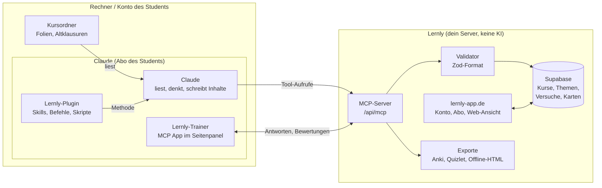

# Lernly als Claude-Plugin: Architekturplan (Claude-Code-Fassung, Version 2)

Stand: 13.11.2026. Ersetzt Version 1 dieser Datei, die Lernly noch als App mit Claude als Zulieferer geplant hat. Grundlage: dein [CF Study OS](https://claude.ai/artifact/EbKXQ41UYHRo5aZPAzZEDF) (Quellcode gelesen), dein Skill `corporate-finance-tutor` mit vorbereitetem Kursordner, die Lernly-Codebase und Anthropics Doku zu Plugins, Connectors und MCP Apps (Quellen am Ende). Nichts davon ist gebaut. Token- und Kostenzahlen sind Schätzungen.

---

## 0. Was du willst und mein Urteil

**Was du willst:** Lernly ist keine SaaS mehr, die selbst KI bezahlt. Lernly ist ein Paket für Claude. Alles läuft im Claude des Students. Lernly liefert die Vorarbeit: was in einen guten Klausurtrainer gehört, in welcher Reihenfolge und in welchem Format. Ergebnis: perfekte Lernmaterialien mit wenigen Prompts und wenig Tokens, für etwa 5 € im Monat.

**Urteil: Das ist machbar, und Anthropic sieht genau dieses Modell vor.** Für ein eigenes Produkt empfiehlt die Doku zwei Einreichungen ins Claude-Verzeichnis: den eigenen Server als MCP-Connector und dazu ein Plugin, dessen Skills Claude beibringen, wie man ihn benutzt.

Lernly besteht dann aus:

- **Plugin** (Skills, Befehle, Skripte) = deine Vorarbeit. Kostet dich im Betrieb nichts.
- **Connector** (MCP-Server) = die fertige Lern-Oberfläche, die in Claude läuft, dazu Kursgedächtnis, Fortschritt, Exporte und Bezahlschranke. Kostet dich nur Hosting, keine KI.

Für dich ist es günstig, weil keine API-Kosten mehr anfallen. Für den Student ist es sparsam, weil Claude die Oberfläche nie selbst schreibt, sondern nur Inhalte liefert.

**Zwei unbequeme Punkte vorab:**

1. **Skills sind lesbarer Text.** Wer das Plugin hat, kann sie kopieren. Bezahlt wird deshalb der Connector, nicht das Wissen in den Skills (Abschnitt 11).
2. **Dein Markt wird kleiner:** Studis mit Claude Pro. Das Plugin-Verzeichnis gibt es ab Pro, Cowork mit Ordnerzugriff auch, und die Gratis-Limits reichen nicht für 500 Folien.

---

## 1. Wo heute die Tokens verbrennen

Dein CF-Ablauf hat schon die richtige Grundidee: ein vorbereiteter Kursordner mit `00_COURSE_OVERVIEW.md`, `00_INDEX.md` und `_Text (for Claude)`. Trotzdem gibt es fünf Lecks:

| Leck | Was passiert | Größenordnung (Schätzung) | Lösung im Plugin |
|---|---|---|---|
| Oberfläche jedes Mal neu | Claude schreibt CSS, Navigation, Wiederholungslogik, Timer und Dashboard selbst (in deinem CF Study OS rund 80 KB Code) | ca. 20–25k Ausgabe-Tokens pro Trainer | Die Oberfläche liegt fertig im Connector (MCP App). Claude schreibt nur Inhalte |
| Bei Fehlern alles neu | Ein kaputter Tab bedeutet, dass das ganze Artefakt neu geschrieben wird | 80–120k Ausgabe-Tokens pro Neuversuch | Speichern Thema für Thema. Der Validator meldet Fehler, eine Korrektur betrifft ein Thema (3–8k) |
| Folien teuer lesen | PDFs mit Grafiken kosten pro Seite ein Vielfaches von reinem Text, und meist wird alles gelesen | 500 Folien als Text ca. 200k, mit Bildern ein Vielfaches | Ein Skript zieht den Text einmal heraus. Altklausuren kommen zuerst, gründlich gelesen wird nur, was laut Bauplan Punkte bringt |
| Jede Session von vorn | Eine neue Unterhaltung liest wieder Ordner und Übersicht | 20–100k Eingabe-Tokens pro Session | Das Kursgedächtnis im Connector liefert Bauplan, Themen und Lernstand in 5–10k Tokens |
| Format-Ballast | HTML-Markup um jeden Absatz (`<div class="simple">…`) | ca. 30 % der Inhalts-Tokens | Kompaktes JSON mit Markdown |

**Erwartung:** pro Kurs grob 60–80 % weniger Ausgabe-Tokens und 50–70 % weniger Eingabe-Tokens als freihändig. Das ist eine Größenordnung, keine Messung. Phase 0 misst es.

---

## 2. Das Produkt: drei Teile

| Teil | Inhalt | Läuft wo | Kostet dich |
|---|---|---|---|
| **Lernly-Plugin** | Skills (Methode), Befehle, Referenzdateien, Skripte, Verweis auf den Connector | Chat (Web, Desktop, Mobile), Cowork, Claude Code | 0 € |
| **Lernly-Connector** | MCP-Server: Kursgedächtnis, Inhalte speichern und prüfen, Fortschritt, Exporte, Bezahlschranke | überall, wo Connectors laufen | Hosting |
| **Lernly-Trainer** (MCP App) | Die fertige Oberfläche aus deinem CF Study OS: im Seitenpanel oder als Vollbild (Web, Desktop), im Chat (Mobile) | Web, Desktop, Mobile | Hosting |

lernly-app.de bleibt bestehen für Konto, Bezahlung, Anleitung und eine Web-Ansicht desselben Trainers. Die braucht man fürs Handy außerhalb von Claude und zum Teilen mit der Lerngruppe.

---

## 3. Ablauf für den Student

**Einmalig:** Plugin „Lernly" im Claude-Verzeichnis hinzufügen, im Tab „Connectors" des Plugins mit dem Lernly-Konto anmelden. Bis das Verzeichnis freigibt, gibt es das Plugin als ZIP oder Marketplace-URL. Das ist mehr Aufwand für den Nutzer.

**Pro Kurs:**

1. **`/lernly:kurs-einrichten`** (in Cowork mit Ordner oder mit Dateien im Chat): Claude erfasst die Dateien, zieht per Skript den Text heraus, liest Altklausuren zuerst und erstellt das **Kursprofil**: Prüfungsform, Bauplan mit Punkten und Häufigkeit, Themenliste mit Folienbereichen, Notation des Profs. Das Profil wird im Connector gespeichert. In Cowork landet zusätzlich `00_LERNLY.md` im Ordner, wie bei deinem CF-Setup.
2. **Eine Rückfrage:** Der Student bestätigt oder korrigiert den Bauplan.
3. **`/lernly:trainer-bauen`:** Claude schreibt Thema für Thema im kompakten Format, der Validator prüft jedes Thema, danach öffnet sich der Trainer im Seitenpanel.
4. **Lernen im Trainer:** Klausurplan, Themen, Rechnen, Wiederholen, Probeklausur, Spickzettel. Der Fortschritt wird bei Lernly gespeichert und ist auf allen Geräten verfügbar.
5. **`/lernly:wo-stehe-ich`, `/lernly:abfragen`, `/lernly:erklaer-mir`:** Claude holt Lernstand und Kursprofil (wenige Tokens) und übt gezielt die schwächsten Themen. Das läuft wie dein CF-Tutor: erst selbst versuchen lassen, dann Schritt für Schritt korrigieren, Folie zitieren.
6. **Neue Folien:** `/lernly:kurs-aktualisieren` verarbeitet nur die neuen Dateien.

---

## 4. Architektur



Grundsatz: **Lernly sieht nie die Rohdateien und ruft nie ein Sprachmodell auf.** Claude liest und schreibt. Lernly speichert, prüft, zeigt an und merkt sich den Lernstand.

---

## 5. Plugin im Detail: die Vorarbeit

```
lernly/
  .claude-plugin/plugin.json
  .mcp.json                         Verweis auf https://lernly-app.de/api/mcp
  README.md, LICENSE                Pflicht fürs Verzeichnis
  skills/
    lernly-kurs-einrichten/
      SKILL.md                      Inventar → Text → Altklausuren → Bauplan → Kursprofil
      scripts/inventory.py          Dateien, Seitenzahl, Typ (Folie, Übung, Altklausur, Lösung)
      scripts/extract_text.py       PDF/PPTX → Text pro Seite mit Seitennummer
      references/kursprofil.md      Format des Kursprofils
    lernly-trainer-bauen/
      SKILL.md                      Methode: Stufen, Bausteine je Thema, Reihenfolge
      references/format.md          kompaktes Inhaltsformat
      references/fachtypen.md       Rechnen, Verstehen, Argumentieren, Gemischt
      references/beispiel-dcf.json  ein perfektes Thema aus deinem CF Study OS
      references/qualitaet.md       Checkliste vor dem Speichern
    lernly-tutor/
      SKILL.md                      Tutor-Regeln (dein CF-Tutor, verallgemeinert)
  commands/
    kurs-einrichten.md  trainer-bauen.md  kurs-aktualisieren.md
    wo-stehe-ich.md  abfragen.md  probeklausur.md  export.md
```

Die Methode in `lernly-trainer-bauen` stammt aus deinem CF Study OS:

1. **Bauplan zuerst:** aus Altklausuren Aufgabenblöcke, Punkte, Häufigkeit, Pflicht oder Wahl, Dauer und Hilfsmittel ableiten. Ohne Altklausur: Relevanz als „vermutet" markieren.
2. **Stufen:** Stufe 1 „sicher lernen" (ca. 70 % der Punkte), Stufe 2 „wenn Zeit ist", Stufe 3 „nur wenn alles sitzt".
3. **Pro Thema:** einfach erklärt, Beispiel, Grafik, Rezept in Schritten, Formeln, durchgerechnete Altklausuraufgabe, Standardantwort mit Schlüsselwörtern, typische Fehler, Merkhilfe, Quelle.
4. **Üben:** Altklausuraufgaben zuerst, dann Varianten. Rechnen mit Eingabe, Toleranz und Lösungsweg. Text mit Punkte-Checkliste. MC mit Erklärung.
5. **Auswendig nur, was man 1:1 hinschreiben muss.**
6. **Probeklausuren** im echten Format, **Spickzettel**.

Fachtypen bestimmen die Mischung: Rechnen (Mathe, Statistik, Finance) bekommt vor allem Übungsaufgaben mit Varianten, Verstehen (Marketing, Orga) vor allem Karteikarten und Modelle, Argumentieren (Strategie, Essays) vor allem Musterantworten mit Punkte-Checkliste.

Technische Hinweise:

- Skript-Skills brauchen im Chat aktivierte Code-Ausführung (Gratis, Pro, Max: Einstellungen → Funktionen). In Cowork laufen sie in der VM.
- Kein `bin/`-Ordner im Plugin, sonst lehnen Chat und Cowork die Installation ab.
- Keine Geheimnisse in Plugin-Dateien. Jeder Nutzer bekommt alle Dateien.

---

## 6. Connector-Tools (MCP)

| Tool | Zweck | Schreibt |
|---|---|---|
| `lernly_get_course(course_id?)` | Kursliste, oder Kursprofil plus Lernstand in kompakter Form | nein |
| `lernly_save_course(profile)` | Kursprofil anlegen oder aktualisieren (Bauplan, Themen, Notation, Prüfungsdatum) | ja |
| `lernly_save_topic(course_id, topic)` | Ein Thema speichern. Antwort: Fehlerliste oder ok | ja |
| `lernly_save_mock(course_id, mock)` | Eine Probeklausur speichern | ja |
| `lernly_open_trainer(course_id, tab?)` | Öffnet die Oberfläche (MCP App) | nein |
| `lernly_get_progress(course_id)` | Mastery je Thema, schwächste Aufgaben, fällige Karten, Mock-Ergebnisse | nein |
| `lernly_export(course_id, format)` | Link zu Anki-Datei, Quizlet-Text oder Offline-HTML | nein |

Der Trainer selbst ruft zusätzlich zwei Tools auf, die Claude nicht braucht: Antwort speichern und Karte bewerten.

**Bezahlschranke, ohne Fake:** Ohne Abo funktioniert ein Kurs komplett. Beim zweiten Kurs antwortet `lernly_save_course` mit einem klaren Hinweis und dem Abo-Link. Claude gibt das an den Student weiter.

Tool-Namen und Beschreibungen bleiben stabil, weil jede Änderung in Claude neue Freigabe-Abfragen auslöst.

---

## 7. Trainer-Oberfläche (MCP App)

- Ein HTML/JS-Paket aus Lernly-Komponenten als `ui://lernly/trainer`. Es öffnet sich nach Möglichkeit im Seitenpanel (`preferredDisplayMode: fullscreen`) und hat einen eigenen Vollbild-Knopf. Auf dem Handy erscheint es im Chat.
- Tabs (Deutsch): **Klausurplan · Themen · Wiederholen · Probeklausur · Spickzettel · Übersicht**.
- Logik aus deinem CF Study OS:
  - Mastery = 15 % Theorie gelesen + 70 % Übung + 15 % Karten.
  - Priorität = erwartete Punkte × (1 − Mastery).
  - Kopfzeile: „Punkte, die du jetzt holen würdest".
- Fortschritt geht per Tool-Aufruf an Lernly, nicht in `localStorage`. Damit ist er auf jedem Gerät und in jeder neuen Unterhaltung da.
- Die Sandbox erlaubt keine Downloads und keine Pop-ups. Exporte öffnen deshalb lernly-app.de.
- Das Seitenpanel gibt es derzeit nur für einen Teil der Konten. Ohne Panel öffnet der Knopf Vollbild, sonst bleibt die Ansicht im Chat.
- Dasselbe Paket läuft als Web-Ansicht unter lernly-app.de.

---

## 8. Inhaltsformat (kompakt)

Ein Kurs besteht aus Kursprofil, Themen, Probeklausuren und Spickzettel. Kurzform:

```ts
Kursprofil = { title, language, exam: { date, durationMin, totalPoints, aids,
               parts: [{ id, name, points, slots: [{ id, label, points, choiceGroup? }] }],
               fidelity: "strict" | "likely" | "broad" },
               topics: [{ id, title, slotIds, expectedPoints, tier, sources }],
               notation?: string }

Thema = { id, theory: Block[], standardAnswer?: Block[], tasks: Task[],
          cards: [{ id, front, back }], mistakes?: string[], hook?: string }

Block = text | simple | example | remember | steps | formula (LaTeX) | table | figure (SVG) | model_answer
Task  = drill (3–5 durchgerechnete Varianten, Felder mit Toleranz, Lösungsweg)
      | essay (Aufgabe, Punkte, Checkliste, Musterantwort)
      | mc (Fragen, Optionen, richtige Antwort, Erklärung)
```

Regeln:

- Markdown-light plus LaTeX.
- SVG wird nur als Bild angezeigt (kein Skript möglich).
- Kein freies HTML oder JS.
- Stabile IDs, damit Updates keinen Fortschritt löschen.

---

## 9. Datenmodell: nur neue Tabellen

Die Datenbank ist zwischen Preview und Produktion geteilt. Deshalb kommen nur neue Tabellen dazu, die laufende App bleibt unberührt.

| Tabelle | Felder | Zweck |
|---|---|---|
| `lernly_courses` | `id`, `user_id`, `exam_id` (optional, nutzt Countdown und Erinnerungen der bestehenden `exams`), `title`, `language`, `profile jsonb`, `status`, Zeitstempel | Kurs und Kursgedächtnis |
| `lernly_course_items` | `course_id`, `item_type` (`topic` / `mock` / `cheatsheet`), `item_id`, `content jsonb`, `version`, `updated_at`, eindeutig je Kurs und `item_id` | Inhalte, einzeln speicherbar |
| `lernly_attempts` | `user_id`, `course_id`, `item_id`, `kind`, `score`, `answer jsonb`, `created_at` (nur anhängen) | Lernstand |
| `lernly_card_reviews` | wie die bestehende `card_reviews`, aber mit `course_id` | Wiederholung |

RLS gilt nur für den Eigentümer. Migrationsdateien bekommen einen 14-stelligen Zeitstempel und werden erst nach deinem OK eingespielt. OAuth-Clients verwaltet Supabase selbst.

---

## 10. Kosten und Preis

**Laufende Kosten:** keine KI. Fixkosten fürs Hosting (Supabase Pro und Vercel Pro) liegen laut Anbieterpreisen bei rund 40 €/Monat Basis, plus Mehrverbrauch. Ein Kurs ist ca. 100–300 KB JSON, also pro Nutzer fast nichts.

| Modell | Brutto | Netto nach 19 % USt. und Stripe | KI-Kosten pro Nutzer | Abos für 10k € MRR |
|---|---|---|---|---|
| **Lernly Plus 4,99 €/Monat** | 4,99 € | ≈ 3,83 € | 0 € | ≈ 2.000 |
| **Lernly Plus 29,99 €/Semester** (6 Monate) | 5,00 €/Monat | ≈ 4,05 €/Monat | 0 € | ≈ 2.000 |
| Zum Vergleich: heute 8,99 €/Monat | 8,99 € | ≈ 7,10 € | 0,5–1 € pro Paket | ≈ 1.100 |

**Empfehlung:**

- **Gratis:** ein Kurs komplett (Trainer, Fortschritt, Tutor).
- **Lernly Plus** für 4,99 €/Monat oder 29,99 €/Semester: unbegrenzte Kurse, Exporte, Web-Ansicht, Teilen mit der Lerngruppe. 29,99 € ist genau dein heutiger Semesterpreis, dafür braucht es keinen neuen Stripe-Preis.
- **Ehrlich gerechnet:** Bei 4,99 € brauchst du für denselben Umsatz etwa doppelt so viele zahlende Nutzer wie bei 8,99 €. Dafür ist jeder Nutzer ab dem ersten Tag profitabel, und Vielnutzer können dich kein Geld mehr kosten.
- **Der Student zahlt zusätzlich sein Claude-Abo.** Phase 0 fragt, ob das für ihn passt.
- Neue Preise und Pläne betreffen Billing, das entscheidest du.

---

## 11. Was kopierbar ist und was du verkaufst

- **Skills sind Text.** Wer das Plugin hat, kann sie lesen und weitergeben. Das ist in Ordnung: Sie sind dein Marketing und machen Claude auch ohne Abo besser.
- **Verkauft wird, was Claude allein nicht kann:** eine fertige Oberfläche ohne Token-Kosten, Lernstand über Wochen und Geräte, ein Kursgedächtnis, Exporte und das Teilen mit der Lerngruppe.
- **Späterer echter Vorsprung: die Kurs-Bibliothek.** Wenn 40 EBS-Studis denselben CF-Kurs haben, baut der Erste den Bauplan, alle anderen starten in Sekunden und mit fast null Tokens. Vorher rechtlich prüfen lassen, denn die Inhalte sind aus Folien und Altklausuren abgeleitet.

---

## 12. Dateien und riesige Foliensätze

- **Claude liest, Lernly nie.** Am besten in Cowork (ab Pro): Ordner freigeben, fertig. Im Chat: Dateien anhängen (Claudes Grenzen gelten) oder einen Drive-Connector nutzen.
- **`extract_text.py`** zieht den Text einmal pro Seite mit Seitennummer heraus. Danach liest Claude nur noch Text. Seiten mit Diagrammen schaut es sich gezielt als Bild an.
- **1-GB-Foliensätze:** Die Datei bleibt lokal, das Skript liest seitenweise. Für große Kurse deshalb Cowork empfehlen.

---

## 13. Anki und Quizlet

- **Anki:** `lernly_export(format: "anki")` liefert einen Link zu einer Textdatei mit Anki-Kopfzeilen, ohne neue Abhängigkeit. `.apkg` kommt erst, wenn Nutzer danach fragen. Ein Live-Sync geht nicht: Anki ist nur lokal erreichbar, und AnkiWeb importiert keine Pakete.
- **Quizlet:** Es gibt einen offiziellen Quizlet-Connector in Claude, der Studis Sets direkt erstellt. Dazu liefert `lernly_export(format: "quizlet")` Text zum Einfügen. Einen eigenen Sync gibt es nicht, weil Quizlet keine API anbietet.

---

## 14. Was mit der heutigen App passiert

- Sie läuft weiter für bestehende Nutzer und Abos. Keine Löschungen, keine Änderung an Live-Tabellen.
- Keine neuen Features. Die Landing wird in Phase 2 auf das Plugin umgestellt.
- Später, mit deinem OK: KI-Generierung für Neukunden abschalten. Dann fallen keine API-Kosten mehr an.

---

## 15. Phasen

| Phase | Dauer (geschätzt) | Inhalt | Weiter, wenn |
|---|---|---|---|
| **0: Plugin ohne Server** | 2–3 Tage Bau, 1 Woche Test | Plugin nur mit Skills, Befehlen und Skripten. Ausgabe: der Trainer als HTML-Datei aus einer mitgelieferten Vorlage (`assets/trainer.html` + `scripts/build_trainer.py`). Claude schreibt nur das JSON, das Skript setzt es in die Vorlage. 6 Studis mit Claude Pro, dazu TikTok mit deinem CF Study OS | ≥ 4 von 6 bauen in ≤ 3 Prompts einen Trainer und nutzen ihn für eine echte Klausur |
| **1: Connector + Trainer** | 3–4 Wochen | MCP-Server mit OAuth, Kursgedächtnis, Trainer als MCP App und Web-Ansicht, Fortschritt, Bezahlschranke, Exporte | 10 Tester: ≥ 6 lernen an ≥ 3 Tagen damit, ≥ 3 zahlen |
| **2: Verzeichnis + Launch** | ca. 1 Woche plus Prüfzeit (nicht fest) | Connector und Plugin einreichen, öffentliches GitHub-Repo fürs Plugin, README, Lizenz, Datenschutz, Landing umstellen | Listing ist live |
| **3: Vorsprung** | offen | Kurs-Bibliothek, dieselbe App in ChatGPT (MCP Apps ist ein offener Standard) | nach Nutzerdaten |

Phase 0 testet gleichzeitig die Methode und die Token-Ersparnis. Ob Claude die HTML-Datei im Chat direkt als Vorschau zeigt, prüfe ich im Test. Fallback: herunterladen und im Browser öffnen, der Fortschritt bleibt dann im Browser.

Aufwand Phase 1: MCP-Server und OAuth 4–6 Tage, Trainer (Engine aus CF Study OS nach React portieren, als MCP App und Web-Ansicht) 6–9 Tage, Datenmodell und Validator 2 Tage, Bezahlschranke 1–2 Tage, Exporte 1 Tag.

---

## 16. Risiken

| Risiko | Gegenmaßnahme |
|---|---|
| Zu wenige Studis haben Claude Pro | Phase 0 fragt danach. ChatGPT folgt über denselben Standard |
| Anthropic ändert Regeln oder baut selbst eine Lernfunktion | MCP ist offen. Inhalte und Fortschritt liegen bei Lernly |
| Seitenpanel nur für einen Teil der Konten | Vollbild oder Chat-Ansicht als Rückfall |
| Prüfzeit im Verzeichnis ist offen | Bis dahin ZIP-Upload oder Marketplace-URL mit Anleitungsvideo |
| Gratis-Claude: Code-Ausführung muss an sein, die Limits sind klein | Pro empfehlen, Setup-Seite erklärt den Schalter |
| Skills sind kopierbar | Der Wert liegt im Connector (Abschnitt 11) |
| Bezahldienst hinter einem Verzeichnis-Connector | Laut Doku üblich (Anbieter darf eigenes Konto oder Abo verlangen). Software Directory Policy vor dem Einreichen lesen |

---

## 17. Was ich von dir brauche

- **Phase 0:** OK, dass ich das Plugin im Repo unter `plugin/lernly/` anlege (nur Markdown, JSON und zwei, drei Python-Skripte, keine App-Änderung). Dazu 6 Studis mit Claude Pro und echter Klausur.
- **Phase 1:**
  - neue Abhängigkeiten `@modelcontextprotocol/sdk` und `@modelcontextprotocol/ext-apps`
  - Auth-Änderung: OAuth-Server in Supabase einschalten
  - 4 neue Tabellen
  - Preisentscheidung (4,99 €/Monat braucht einen neuen Stripe-Preis)
  - neue Env-Variablen sage ich dir an, sie müssen in Production, Preview und Development gesetzt werden
- **Phase 2:** öffentliches GitHub-Repo fürs Plugin, einen Datenschutz-Abschnitt vom Anwalt, Einreichung über dein Pro-Konto.

---

## 18. Was sich gegenüber Version 1 und Astra ändert

| Punkt | Version 1 / Astra | Jetzt |
|---|---|---|
| Wo gelernt wird | Lernly-App ist der Lernort, Claude der Zulieferer | Claude ist der Ort. Lernly ist Plugin und Connector, die App nur noch Konto, Bezahlung und Web-Ansicht |
| Wie die Methode zu Claude kommt | Server-Instructions (V1) bzw. Fachanweisungen (Astra) | Skills im Plugin, mit Skripten für Textextraktion. Offiziell so vorgesehen |
| Preis | Heutige Preise behalten | 4,99 €/Monat oder 29,99 €/Semester, keine KI-Kosten |
| Umfang | V1 drei Tabellen, Astra rund 20 | Vier neue Tabellen, keine Desktop-Brücke, keine Dateiindexierung bei Lernly |

---

## Quellen

- [Claude Docs: Connectors, Skills und Plugins](https://claude.com/docs/extend/overview.md)
- [Claude Docs: Plugins](https://claude.com/docs/plugins/overview.md) · [Plugin-Aufbau und Tests](https://claude.com/docs/plugins/build.md) · [Unterstützung je App](https://claude.com/docs/plugins/platform-support.md)
- [Claude Docs: Ins Verzeichnis einreichen](https://claude.com/docs/directory/publish.md)
- [Claude Docs: Connectors nutzen](https://claude.com/docs/connectors/overview.md)
- [Claude Docs: MCP Apps im Seitenpanel und Vollbild](https://claude.com/docs/connectors/building/mcp-apps/display-modes)
- [Anthropic: Interaktive Connectors und MCP Apps](https://claude.com/resources/articles/interactive-tools-in-claude)
- [Claude Help: Custom Connectors](https://support.claude.com/en/articles/11175166-get-started-with-custom-connectors-using-remote-mcp) · [Skills](https://support.claude.com/en/articles/12512180-use-skills) · [Cowork](https://support.claude.com/en/articles/13345190-get-started-with-cowork)
- [Claude Agent SDK: Kein claude.ai-Login für Drittprodukte](https://code.claude.com/docs/en/agent-sdk/overview)
- [MCP Blog: MCP Apps](https://blog.modelcontextprotocol.io/posts/2026-01-26-mcp-apps/)
- [Claude Marketplace: Quizlet-Connector](https://claude.com/marketplace/connectors/quizlet) · [Quizlet-Import](https://help.quizlet.com/hc/en-us/articles/360029977151-Creating-study-sets)
- [Anki-Handbuch: Packaged Decks](https://docs.ankiweb.net/manual/importing/packaged-decks)
- [Supabase: OAuth 2.1 Server für MCP](https://supabase.com/docs/guides/auth/oauth-server/mcp-authentication)
