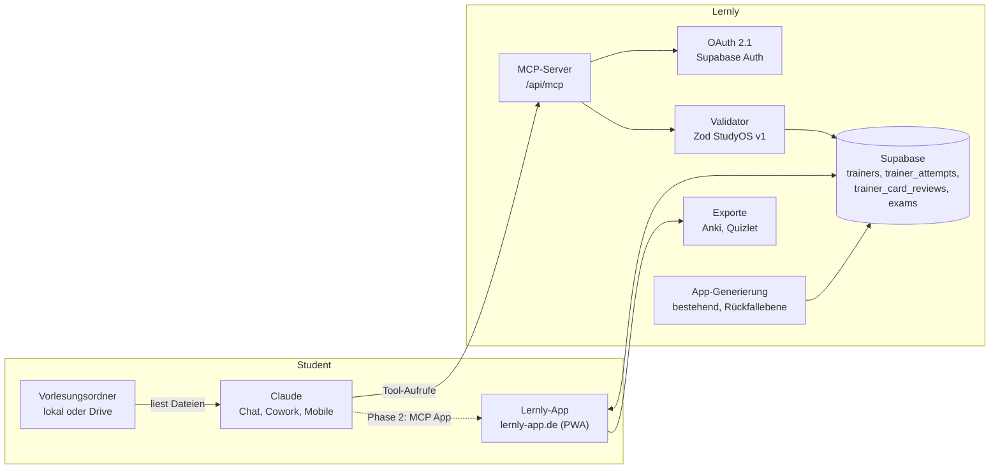

# Lernly × Claude: Architekturplan (Claude-Code-Fassung)

Stand: 13.11.2026. Grundlage: Codebase auf `main` (bd54ba2), dein Artefakt [CF Study OS](https://claude.ai/artifact/EbKXQ41UYHRo5aZPAzZEDF) (Quellcode gelesen, nicht nur die Oberfläche) und aktuelle Primärquellen (Liste am Ende). Nichts davon ist gebaut. Alle Kostenangaben sind Schätzungen mit offengelegten Annahmen.

---

## 0. Kurzfassung

**Entscheidung:** Claude baut den Trainer, Lernly speichert ihn, spielt ihn ab und merkt sich den Lernstand. Der Student arbeitet mit seinem eigenen Claude (seine Dateien, sein Abo). Lernly hängt als MCP-Connector dran. Gelernt wird in der Lernly-App auf dem Handy und ab Phase 2 zusätzlich direkt im Claude-Chat (MCP App).

**Warum:** Der stärkste Befund kommt von dir selbst. Du lernst lieber mit Claude als mit Lernly. Das liegt nicht am Modell, sondern am Ablauf (Abschnitt 1). Diesen Ablauf kann Lernly nicht günstig nachbauen, Claude liefert ihn schon. Lernlys Wert wird damit: die **Methode** (dein Study-OS-Rezept), der **dauerhafte Lernstand** über Kurse und Geräte und die **Prüfungslogik** („Punkte, die du jetzt holen würdest").

**Reihenfolge:**

| Phase | Dauer | Inhalt | Weiter nur wenn |
|---|---|---|---|
| 0 | 1 Woche, kein Code | Methode als Anleitung, 6 Studis bauen ihren Trainer in Claude, TikTok mit deinem CF Study OS | ≥ 4 von 6 nutzen ihn für eine echte Klausur |
| 1 | ca. 2 bis 3 Wochen | Inhaltsformat, Lernly-Player, MCP-Server mit 7 Tools, Anki-/Quizlet-Export | ≥ 6 von 10 Testern lernen an ≥ 3 Tagen damit |
| 2 | ca. 1 Woche + Prüfzeit | Player als MCP App im Claude-Chat, Eintrag im Connector-Verzeichnis | Einrichtung klappt ohne deine Hilfe |
| 3 | 1 bis 2 Wochen | App-Pfad für Studis ohne Claude: neues Format, neue Modelle, Text-Extraktion im Browser | Phase 0/1 zeigen, wie viele kein Claude haben |

Das Timing passt: Wintersemester-Klausuren liegen im Januar und Februar. Phase 1 kann Mitte Dezember stehen.

---

## 1. Warum dein Claude-Artefakt besser ist als Lernly heute

| | CF Study OS (Claude) | Lernly heute (Code) |
|---|---|---|
| Material | Alle Folien, Altklausuren 2015 bis FT23, Musterlösungen, Addenda, Gastvortrag. Claude liest gezielt nach. | Upload bis 50 MB. Text wird ab ca. 120k Tokens gekürzt (`TOKEN_THRESHOLD_CHARS`, [generatePack.ts](../../src/lib/generatePack.ts)), Bilder-PDFs max. 100 Seiten. |
| Prüfungsanalyse | Klausur-Slots Q1 bis Q6, Punkte je Aufgabe, Häufigkeit („5 of 5 old exams"), Entweder-oder-Paare, Open-Book vs. Closed-Book | Optionale Altklausur-Lens mit Relevanz-Tags |
| Ablauf | Mehrere Runden, Rückfragen, Nachbessern bis es passt | Ein Durchlauf, 4 parallele Teilaufgaben mit festen Token-Grenzen (4k bis 16k), bei Überlauf „antworte halb so lang" |
| Modell | Spitzenmodell mit Denken | Sonnet 4.6 und Haiku 4.5, `thinking: disabled` ([taskModels.ts](../../src/lib/taskModels.ts)) |
| Inhaltsformen | Erklärung „in einfachen Worten", Beispiel, SVG-Grafik, 6-Schritte-Rezept, Formeln (LaTeX), durchgerechnete Altklausur, Musterantwort in Klausursprache mit markierten Schlüsselwörtern, typische Fehler, Merkhilfe, Folienquelle | Karteikarten, MC oder offene Fragen, Study Guide |
| Üben | Rechen-Drills mit neuen Zahlen und Rundungstoleranz, Textaufgaben mit Punkte-Checkliste zum Selbstbewerten, 4 Probeklausuren mit Lern- und Klausurmodus (90-Minuten-Timer) | MC-Quiz mit Erklärungen, Re-Practice |
| Steuerung | „Points you would score now: x/90", Rangliste nach erwarteten Punkten × Lücke, „Do next", „Where it is stuck" | Mastery-% pro Paket, Fällig-Queue, Streak |

**Folgerung:** Ein Connector allein macht Lernly nicht besser. Besser wird es durch zwei Dinge zusammen: Claude erzeugt mit vollem Material, Denken und Iteration, und Lernly kann endlich das Format abspielen, das in deinem Artefakt funktioniert.

Dein Artefakt ist technisch schon fast so gebaut, wie Lernly es braucht: eine feste **Engine** (Router, Mastery-Formel, SRS, Mock-Timer, Speicherung) und davon getrennte **Kursdaten** (`TOPICS`, `PRACTICE`, `DRILLS`, `ESSAYS`, `MEMO`, `MOCKS`, `CHEAT`). Lernly übernimmt die Engine, Claude liefert die Daten.

---

## 2. Was erlaubt ist und was nicht

| Weg | Wer zahlt die KI | Erlaubt? | Rolle im Plan |
|---|---|---|---|
| Student arbeitet in Claude, Claude ruft Lernly-Tools auf (MCP-Connector) | Claude-Abo des Students | Ja, offizieller Weg | **Hauptweg** |
| Lernly-Ansicht läuft im Claude-Chat (MCP App) | Claude-Abo | Ja, seit 26.01.2026 | Phase 2 |
| Artefakt in Claude ruft selbst Claude auf | Abo des jeweiligen Nutzers | Ja, aber Speicher und Connectoren nur in bezahlten Plänen, nur Web/Desktop | Nicht gewählt: Fortschritt bliebe im Artefakt gefangen |
| lernly-app.de nutzt im Hintergrund das Claude-Abo des Students | – | **Nein.** Anthropic erlaubt Drittanbietern ohne Freigabe weder claude.ai-Login noch Abo-Limits für eigene Produkte | Ausgeschlossen |
| lernly-app.de ruft die Claude-API auf | Lernly (oder eigener API-Key des Nutzers) | Ja | Bestehender App-Pfad als Rückfallebene |

Planverfügbarkeit (Primärquellen, Stand heute):

- **Custom Connectors:** Free (max. 1), Pro, Max, Ultra, Team, Enterprise. Hinzufügen im Web oder Desktop, danach auch in der Mobile-App nutzbar.
- **Interaktive Connectors (MCP Apps):** Web, Desktop, Mobile, alle Pläne. Neuere Extras (App-Tools, Einstiegspunkte, eingebettete Seiten) sind an Verzeichnis-Status und Organisations-Rollout gebunden.
- **Cowork (Ordnerzugriff):** ab Pro, Mac und Windows.

**Was das für die Zielgruppe heißt:** Realistisch nutzt den Claude-Weg ein Student mit Claude Pro. Ein 500-Folien-Kurs sprengt die Free-Limits, und Ordnerzugriff gibt es erst ab Pro. Wie viele BWL-Studis in DACH Claude Pro haben, weißt du nicht. Das misst Phase 0. Der App-Pfad bleibt deshalb bestehen.

---

## 3. Zielarchitektur



Grundsatz: **Lernly sieht nie die Rohdateien.** Claude liest Folien und Altklausuren, Lernly bekommt nur den fertigen Lerninhalt plus kurze Quellenangaben („Folie 51"). Das löst das Upload-Problem, spart Storage und verringert die rechtliche Angriffsfläche beim Speichern fremder Vorlesungsfolien (vom Anwalt bestätigen lassen).

---

## 4. Nutzerfluss (Claude-Pfad)

1. In Lernly: „Mit Claude verbinden". Seite mit drei Schritten und kurzem Video: Connector-URL `https://lernly-app.de/api/mcp` kopieren, in Claude unter Anpassen → Connectors → „Custom Connector hinzufügen" einfügen, mit dem Lernly-Konto anmelden. Einmalig, ca. 2 Minuten.
2. In Claude, idealerweise in Cowork mit freigegebenem Vorlesungsordner: „Bau mir mit Lernly einen Klausurtrainer für Marketing, Klausur am 12.02."
3. Claude ruft `lernly_get_context` (vorhandene Klausuren, Lernstand) und `lernly_get_playbook` (Methode für den Fachtyp) auf.
4. Claude liest Folien und Altklausuren und zeigt zuerst den **Klausur-Bauplan** (Aufgabenblöcke, Punkte, Häufigkeit, Hilfsmittel). Der Student bestätigt oder korrigiert.
5. Claude schreibt Thema für Thema per `lernly_upsert_topic`. Lernly prüft jedes Thema und gibt konkrete Fehler zurück. Claude korrigiert.
6. `lernly_publish` liefert den Link „In Lernly öffnen". Ab hier sind keine Modellaufrufe mehr nötig.
7. Lernen in Lernly auf dem Handy: Klausurplan, Themen, Wiederholen, Probeklausur, Spickzettel. Jede Antwort wird gespeichert.
8. Nächste Session in Claude: „Wo stehe ich?" → `lernly_get_progress` → Claude erklärt gezielt die schwächsten Themen und ergänzt Aufgaben.

Abbruch-sicher: Wenn Claude mitten im Bau ins Nutzungslimit läuft, liegt der Entwurf mit den fertigen Themen schon in Lernly. Die nächste Session macht dort weiter.

---

## 5. Komponenten

### 5.1 MCP-Server `/api/mcp`

- Next.js Route Handler auf Vercel, Transport Streamable HTTP, zustandslos. Bibliothek `@modelcontextprotocol/sdk` (**neue Abhängigkeit, braucht deine Freigabe**).
- Anmeldung: OAuth 2.1 über den OAuth-Server von Supabase Auth (Schalter im Dashboard, Dynamic Client Registration). Zu prüfen: Die MCP-Spec vom 28.07.2026 bevorzugt Client-ID-Metadata-Documents, Claude bietet dafür „Claude's published identity" an. Ob Supabase das unterstützt, testen wir im ersten Durchstich. **Berührt Auth, braucht deine Freigabe.**
- **Server-Instructions** tragen die Kurzfassung der Methode und die Regeln (immer zuerst Bauplan, Sprache folgt dem Material, keine Emojis). Der Student muss dadurch keinen Skill installieren.

| Tool | Zweck | Schreibt |
|---|---|---|
| `lernly_get_context` | Klausuren (Titel, Datum), vorhandene Trainer, Mastery je Thema | nein |
| `lernly_get_playbook(fachtyp, sprache)` | Methode, Kurzreferenz des Formats, Qualitäts-Checkliste, ein Beispielthema (DCF aus deinem Artefakt) | nein |
| `lernly_create_trainer(klausur, bauplan)` | Legt Entwurf an, verknüpft oder erstellt den `exams`-Eintrag | ja |
| `lernly_upsert_topic(trainer_id, thema)` | Ein Thema mit Theorie, Aufgaben, Karten. Antwort: Validierungsfehler oder ok | ja |
| `lernly_upsert_mock(trainer_id, mock)` | Eine Probeklausur | ja |
| `lernly_publish(trainer_id)` | Gesamtprüfung, Status „fertig", Link | ja |
| `lernly_get_progress(trainer_id)` | Mastery je Thema, schwächste Aufgaben, fällige Karten, Mock-Ergebnisse | nein |

Warum Thema für Thema: Ein Trainer wie CF Study OS umfasst mehrere hundert KB Inhalt. Kleine Aufrufe halten jeden Schritt robust, erlauben sofortiges Korrigieren und zeigen dem Student Fortschritt.

Grenzen: max. ca. 60 KB pro Thema, max. 40 Themen, Schreib-Rate-Limit pro Nutzer (vorhandene `rate_limit`-Infrastruktur). Tool-Namen und Beschreibungen stabil halten: Jede Änderung löst in Claude neue Freigabe-Abfragen aus.

### 5.2 Die Methode („Playbook"): das eigentliche Produkt

Abgeleitet aus deinem CF Study OS:

1. **Klausur-Bauplan zuerst.** Altklausuren → Aufgabenblöcke, Punkte, Häufigkeit, Pflicht oder Wahl, Dauer, Hilfsmittel. Ohne Altklausur: Prüfungsform plus Folienschwerpunkte, Relevanz als „vermutet" markiert (die Fidelity-Stufen strict/likely/broad der bestehenden Exam-Lens wiederverwenden).
2. **Stufen:** Stufe 1 „sicher lernen" (ca. 70 % der Punkte bei wenig Aufwand), Stufe 2 „wenn Zeit ist", Stufe 3 „nur wenn alles sitzt".
3. **Pro Thema:** einfache Erklärung, Alltagsbeispiel, Grafik, Rezept in Schritten, Formeln, durchgerechnete Altklausuraufgabe, Standardantwort in Klausurlänge mit Schlüsselwörtern, typische Fehler, Merkhilfe, Quelle.
4. **Üben:** echte Altklausuraufgaben zuerst, dann neue Varianten. Rechnen mit Eingabefeld, Toleranz und Lösungsweg. Text mit Punkte-Checkliste. MC mit Erklärung pro Option.
5. **Auswendig nur, was man 1:1 hinschreiben muss:** Formeln (wenn keine Formelsammlung erlaubt ist), Listen, Gliederungen.
6. **Probeklausuren** im echten Format, Lernmodus und Klausurmodus mit Timer.
7. **Spickzettel** für den letzten Blick.

Fachtypen bestimmen die Mischung, nicht eigene Produktlinien:

| Fachtyp | Beispiele | Schwerpunkt |
|---|---|---|
| Rechnen | Mathe, Statistik, Corporate Finance, KLR | Drills mit Varianten, Lösungsweg, Formelkarten |
| Verstehen und Wiedergeben | Marketing, Organisation, Personal | Karteikarten, Modelle als Grafik, kurze Anwendungsfälle |
| Argumentieren | Strategie, VWL-Essays, Ethik | Standardantworten, Gliederungen, Punkte-Checklisten |
| Gemischt | CF plus Real Estate | alles, gewichtet nach Bauplan |

Positionierung: BWL-Studis. Das ist dein Fach und auf TikTok glaubwürdig. Technisch bleibt alles fachneutral.

### 5.3 Inhaltsformat `study_os_v1` (Zod-Schema in `src/lib/studyOs/schema.ts`)

```ts
StudyOS = {
  format: "study_os_v1",
  title: string,
  language: "de" | "en",            // folgt dem Material
  exam: {
    date?: string, durationMin?: number, totalPoints?: number,
    aids: "closed_book" | "formula_sheet" | "open_book",
    parts: { id, name, points, slots: { id, label, points, choiceGroup? }[] }[],
    fidelity: "strict" | "likely" | "broad",
  },
  topics: {
    id: string,                      // stabile Slug-ID, bleibt bei Updates gleich
    title, partId, slotIds: string[],
    expectedPoints: number, tier: 1 | 2 | 3, frequency?: string, effort?: "S" | "M" | "L",
    pairWith?: string,               // Entweder-oder-Paar
    theory: Block[],
    standardAnswer?: Block[],
    tasks: Task[],
    cards: { id, front, back }[],    // nur Auswendig-Inhalte
    sources: { label, ref }[],       // z. B. "Folien 46–64"
  }[],
  mocks: { id, name, durationMin, items: MockItem[] }[],
  cheatSheet: { title, blocks: Block[] }[],
}

Block =
  | { type: "simple" | "example" | "remember" | "mistakes" | "hook" | "text", md: string }
  | { type: "steps", items: string[] }
  | { type: "formula", tex: string[] }
  | { type: "table", head: string[], rows: string[][] }
  | { type: "figure", svg: string, caption?: string }
  | { type: "model_answer", md: string }          // ==Schlüsselwort== wird markiert

Task =
  | { kind: "drill", id, name, source, variants: { prompt, fields: { label, value, tol? }[],
      choice?: { label, options, correct }, solution: Block[] }[] }
  | { kind: "essay", id, name, source, prompt, points, checklist: { text, points }[], model: Block[] }
  | { kind: "mc", id, name, source, questions: { q, options, correct, explain }[] }
```

Regeln:

- Text ist Markdown-light plus LaTeX `\( \)` und `\[ \]`. KaTeX ist schon im Projekt.
- Grafiken kommen als SVG-Text und werden nur als `` angezeigt. So kann kein Skript laufen, ohne neue Abhängigkeit.
- Kein freies HTML oder JavaScript von Claude. Dein Artefakt erzeugt Drill-Zahlen per JS-Funktion. Version 1 nimmt stattdessen 3 bis 5 fertig durchgerechnete Varianten pro Drill. Version 2 kann Variablen plus Formel mit einem kleinen sicheren Rechner bringen.
- Stabile IDs für Themen, Aufgaben und Karten, damit Updates keinen Fortschritt löschen.

### 5.4 Lernly-Player (Web, mobile-first)

- Neue Route `/dashboard/trainer/[id]`, Tabs (App-Chrome Deutsch): **Klausurplan · Themen · Wiederholen · Probeklausur · Spickzettel · Übersicht**.
- Logik aus deinem Artefakt übernehmen:
  - Mastery je Thema = 15 % Theorie gelesen + 70 % Übung (letzte 3 Versuche, mal Abdeckung) + 15 % Karten.
  - Priorität = erwartete Punkte × (1 − Mastery) × Schwächefaktor. Ist ein Entweder-oder-Partner schon sicher, rutscht das Thema nach hinten.
  - Kopfzeile: „Punkte, die du jetzt holen würdest: 54/90" plus „Als Nächstes".
- Wiederverwenden: `computeNextReview` aus [srs.ts](../../src/lib/srs.ts), Klausuren mit Countdown und Erinnerungen aus `exams`, KaTeX, Streak, Bibliothek nach Klausuren gruppiert.
- Design-System der App (Indigo-CTA, Sora/Inter, lucide-Icons, keine Emojis), ab 380 px nutzbar.

### 5.5 MCP App im Claude-Chat (Phase 2)

- Derselbe Player als UI-Ressource `ui://lernly/trainer`, inline im Chat auf Web, Desktop und Mobile.
- Einschränkungen der Sandbox: keine Downloads, keine Pop-ups, `confirm()` liefert false. Export-Buttons öffnen deshalb lernly-app.de.
- `ui.domain` hängt an der exakten Server-URL. URL früh festlegen und nicht mehr ändern.
- Danach Eintrag im Connector-Verzeichnis beantragen. Ein Klick statt URL kopieren ist für die ersten 2 Minuten entscheidend.

### 5.6 Bestehende App-Generierung

Bleibt für Studis ohne Claude. In Phase 1 keine Arbeit daran. In Phase 3: Ausgabe im neuen Format, Modellwechsel (Abschnitt 8), Text-Extraktion im Browser (Abschnitt 9).

---

## 6. Datenmodell: nur neue Tabellen

Die Datenbank ist zwischen Preview und Produktion geteilt. Deshalb rührt Phase 1 keine bestehende Tabelle an. Der Live-Code auf `main` sieht die neuen Daten nie.

| Tabelle | Wesentliche Felder | Zweck |
|---|---|---|
| `trainers` | `id`, `user_id`, `exam_id` (FK `exams`, optional), `title`, `language`, `format`, `source` (`claude` / `app`), `status` (`draft` / `ready` / `archived`), `content jsonb`, `content_version int`, `created_at`, `updated_at`, `last_opened_at` | Der Trainer selbst |
| `trainer_attempts` | `id`, `user_id`, `trainer_id`, `item_id text`, `kind` (`read` / `drill` / `essay` / `mc` / `mock`), `score real` (0 bis 1), `answer jsonb`, `created_at` | Jeder Versuch, nur anhängen. Mastery wird daraus berechnet |
| `trainer_card_reviews` | wie `card_reviews`, aber mit `trainer_id` | SRS-Stand der Karten |

- RLS: nur Eigentümer. Server-Code mit Service-Role filtert zusätzlich explizit nach `user_id` aus dem OAuth-Token.
- Migrationsdateien mit 14-stelligem Zeitstempel, einzeln per `supabase db query --linked --file …` einspielen, erst nach deinem OK.
- OAuth-Clients und Freigaben verwaltet Supabase selbst. Keine eigene Tabelle nötig.
- `check_pack_quota()` bleibt unverändert. Ein Kontingent für Trainer kommt erst mit der Preisentscheidung (Abschnitt 8).

---

## 7. Sicherheit und Datenschutz

- Jeder Tool-Aufruf prüft den Eigentümer. Fremde Trainer sind über MCP, REST und RLS unerreichbar. Test mit zwei Konten gehört zur Abnahme.
- Tool-Eingaben von Claude sind ungeprüfte Daten: Zod-Validierung, Größengrenzen, kein HTML/JS, SVG nur als Bild.
- „Claude-Verbindung trennen" in den Einstellungen (Freigabe in Supabase widerrufen).
- Datenschutzerklärung braucht einen Abschnitt zum Claude-Connector. Den Text schreibe ich nicht, das ist Sache des Anwalts. Ich liefere nur die technischen Fakten (welche Daten, wohin, wie lange).

---

## 8. Kosten und Preise

### Was ein Paket heute kostet (Schätzung)

Annahmen: Material 50k Tokens (ca. 80 Folien) bzw. 120k Tokens (gekürzte Obergrenze). Typische Ausgaben: Analyse 3k, Visual Map 10k, Quiz/Simulator 8k, Karten 8k, Meta 5k Tokens. Prompt-Caching wie im Code. 1 $ ≈ 0,86 €. Ohne Retries.

| | 50k Tokens | 120k Tokens |
|---|---|---|
| Heute (Sonnet 4.6 + Haiku 4.5) | ≈ 0,57 € | ≈ 0,91 € |
| Nach Modellwechsel (Sonnet 5.5 + Haiku 5.5) | ≈ 0,31 € | ≈ 0,48 € |
| Claude-Pfad (Student zahlt KI über sein Abo) | ≈ 0 € | ≈ 0 € |

Der Modellwechsel ist kein Knopfdruck: Sonnet 5.5 nutzt einen neuen Tokenizer (bis ca. 35 % mehr Tokens), und `thinking: disabled` wird dort abgelehnt (stattdessen `between_tools`). Er braucht einen Qualitätsvergleich auf echtem Material. Die echten Zahlen stehen schon in deinen Vercel-Logs: [generatePack.ts](../../src/lib/generatePack.ts) loggt pro Teilaufgabe `in`, `cache_read`, `cache_write` und `out`. Eine Woche Logs ersetzt meine Schätzung.

### Was pro Plan übrig bleibt

Netto nach 19 % USt. und Stripe (1,5 % + 0,25 €, bei Abos plus 0,7 % Billing), Kosten mit 0,57 € pro Paket:

| Plan | Netto | Volle Nutzung heute | Claude-Pfad |
|---|---|---|---|
| Einzelklausur 4,99 € (5 Pakete) | 3,87 € | 3,87 − 2,85 = **+1,02 €** | ≈ +3,87 € |
| Monatlich 8,99 € (50 Pakete) | 7,10 €/Monat | 7,10 − 28,50 = **−21,40 €** | ≈ +7,10 € |
| Semester 29,99 € (60 Pakete/Monat) | 4,05 €/Monat | 4,05 − 34,20 = **−30,15 €** | ≈ +4,05 € |
| Gratis (2 Pakete) | 0 € | **−1,14 €** pro aktivem Nutzer | ≈ 0 € |

Bei normaler Nutzung (angenommen 6 Pakete im Monat) ist heute alles positiv, beim Semester-Plan aber nur knapp (ca. +0,63 €). Das Risiko sind Vielnutzer und der Gratis-Tarif.

### Empfehlung

1. **Preise lassen.** Nicht senken. Der Claude-Pfad erhöht die Marge, ohne dass du mehr Kunden brauchst. Mehr Umsatz kommt nur über mehr zahlende Nutzer.
2. **Die Einheit ändern, nicht den Preis** (Entscheidung von dir, berührt Billing): Für Claude-Trainer sind „Pakete pro Monat" sinnlos, sie kosten dich fast nichts. Vorschlag: Gratis = 1 Klausur-Trainer komplett. Bezahlt = unbegrenzt Trainer, Exporte, Probeklausuren, plus das bisherige Kontingent für App-Generierung. Ein starker Gratis-Tarif ohne Kosten hilft beim Weitererzählen.
3. **Einzelklausur 4,99 € passt perfekt** zu „ein Trainer für eine Klausur".
4. **Achtung Doppelabo:** Wer den Claude-Pfad nutzt, zahlt Claude und Lernly. Phase 0 fragt deshalb direkt nach Zahlungsbereitschaft.
5. In Phase 1 ändert sich an Stripe nichts.

---

## 9. Dateien und riesige Foliensätze

**Claude-Pfad (Hauptweg):** In Cowork gibt der Student einen Ordner frei. Claude liest Dateien direkt aus dem Ordner, auch große Foliensätze seitenweise. Kein Upload zu Lernly, keine 50-MB-Grenze, keine Indexierung bei Lernly. Ohne Cowork: Dateien in den Chat oder ein Claude-Projekt legen oder einen Drive-Connector nutzen.

**App-Pfad (Phase 3):** Eine Webseite kann keinen Ordner im Hintergrund lesen. Lösung: Der Student wählt Dateien oder einen Ordner aus, der Browser extrahiert den Text lokal (pdf.js bzw. `unpdf` im Web Worker, `unpdf` ist schon im Projekt) und schickt nur den Text plus einzelne Seitenbilder für Diagrammseiten. Aus einem 1-GB-Foliensatz werden wenige MB Text. Ordnerauswahl geht nur in Chrome und Edge am Desktop. Auf dem iPhone bleibt die Dateiauswahl.

---

## 10. Anki und Quizlet

| | Quizlet | Anki |
|---|---|---|
| Offizielle Schnittstelle für uns | Keine. Neue API-Keys gibt Quizlet seit Dezember 2018 nicht mehr aus | Keine Cloud-API. AnkiWeb kann keine `.apkg` importieren |
| Was es schon gibt | **Offizieller Quizlet-Connector in Claude** („Anthropic verified", Tools `generate-flashcards` und `get-flashcards-generation-status`). Er erzeugt Karten aus Material. Ob er eine fertige Kartenliste exakt übernimmt, ist nicht belegt | AnkiConnect (lokales Add-on, Anki-Desktop muss laufen) und mehrere Community-Anki-MCP-Server für Claude Desktop |
| Warum kein eigener Lernly-Connector | Ohne API nicht möglich, Scraping verstößt wahrscheinlich gegen die AGB | Claude-Connectors laufen aus Anthropics Cloud und erreichen `localhost:8765` auf dem Rechner des Students nicht |
| Was Lernly baut | Button „Für Quizlet kopieren": eine Karte pro Zeile, Tab zwischen Begriff und Definition, in Quizlets Import einfügen | Download „Für Anki": Textdatei mit Anki-Kopfzeilen (`#separator:tab`, `#html:true`, `#deck:…`), ohne neue Abhängigkeit. `.apkg` erst, wenn Nutzer danach fragen (bräuchte eine neue Bibliothek) |
| In Claude | Student sagt einfach „mach daraus ein Quizlet-Set". Lernly muss dafür nichts tun | Power-User installieren einen lokalen Anki-MCP selbst. Wir bauen ihn nicht |

Fortschritt aus Anki oder Quizlet fließt nicht zurück nach Lernly. Im Dashboard steht bei exportierten Karten ehrlich „extern gelernt".

---

## 11. Phasen und Abnahme

### Phase 0: Methode testen, ohne Code (1 Woche)

1. Ich schreibe aus deinem CF Study OS das Playbook als ein Anleitungsdokument plus Beispielthema (DCF).
2. 6 BWL-Studis mit echter Klausur in den nächsten Wochen: 2 Marketing, 2 Mathe/Statistik, 2 Finance. Sie bauen mit Playbook und eigenem Material ihren Trainer als Claude-Artefakt, wie du es machst.
3. Parallel TikTok: Bildschirmaufnahme deines CF Study OS, „So habe ich alle Klausuren gelernt". Kommentare und DMs mit „wie?" zählen.
4. Messen: Trainer ohne deine Hilfe gebaut? An ≥ 3 Tagen genutzt? Claude Pro vorhanden? Zahlungsbereitschaft für „das, gespeichert, auf dem Handy, mit Fortschritt"?

**Weiter zu Phase 1, wenn:** ≥ 4 von 6 bauen und nutzen ihn, und ≥ 3 von 6 haben Claude Pro oder würden es holen. Haben die meisten kein Claude, zieht Phase 3 vor Phase 1.

### Phase 1: Claude-Pfad (ca. 2 bis 3 Wochen)

| Baustein | Aufwand (geschätzt) |
|---|---|
| Zod-Schema `study_os_v1`, Validator mit verständlichen Fehlermeldungen | 1 bis 2 Tage |
| Player mit 6 Tabs, Mastery- und Prioritätslogik, mobil | 4 bis 6 Tage |
| MCP-Server mit 7 Tools, Server-Instructions, Playbook | 2 bis 3 Tage |
| OAuth mit Supabase, Test mit echtem Claude (Web und Mobile) | 1 bis 2 Tage |
| 3 Migrationen (nur neue Tabellen), RLS, Zwei-Konten-Test | 1 Tag |
| Anki-Textexport, Quizlet-Kopie, Seite „Mit Claude verbinden" | 1 Tag |

**Abnahme:** Zwei getrennte Testkonten sehen nur ihre eigenen Trainer. Ein echter Kurs (dein CF-Material) läuft komplett durch Claude in Lernly, inklusive Abbruch und Fortsetzen. Der Player funktioniert bei 380 px. 10 Tester: ≥ 6 lernen an ≥ 3 Tagen damit, ≥ 3 wollen zum getesteten Preis zahlen.

### Phase 2: MCP App im Chat (ca. 1 Woche plus Prüfzeit)

Player als UI-Ressource, `lernly_open_trainer`, Antrag fürs Connector-Verzeichnis. Abnahme: Ein neuer Tester richtet alles ohne deine Hilfe in unter 3 Minuten ein.

### Phase 3: App-Pfad (1 bis 2 Wochen)

App-Generierung erzeugt `study_os_v1`, Modellwechsel mit Qualitätsvergleich, Text-Extraktion im Browser. Danach optional: dieselbe MCP-Schnittstelle als ChatGPT-App (dort sind schreibende Custom-Connectors für Privatnutzer eingeschränkt, ein öffentlicher Eintrag braucht OpenAIs Prüfung).

---

## 12. Was ich bewusst nicht baue

- **Keine lokale Lernly-Desktop-App und keine Datei-Indexierung bei Lernly.** Cowork liest Ordner bereits. Das wäre Wochen Arbeit für etwas, das Claude schon kann.
- **Kein Anki-Sync über AnkiConnect und kein Rückkanal aus Quizlet.** Export reicht, bis Nutzer etwas anderes beweisen.
- **Kein Versionierungs-System für Lernobjekte, keine Quellversionen, keine Sync-Cursor.** `content_version` und stabile IDs reichen für Version 1.
- **Keine eigene Quizlet-Integration.** Quizlets Connector existiert in Claude.
- **Keine Arbeit an den B2B-Seiten** (`/hochschulen`, `/pruefungsvorbereitung`) während dieses Umbaus.

---

## 13. Wo ich von Astra abweiche

Einig sind wir uns im Kern: Claude erstellt, Lernly ist der Ort zum Lernen. Ebenso: kein Zugriff auf das Claude-Abo aus dem Lernly-Backend, Anki-Export als Basis, Preise behalten, BWL breit statt nur Finance.

| Punkt | Astra | Ich | Warum |
|---|---|---|---|
| Umfang | Ca. 20 logische Tabellen (Quellversionen, Objektversionen, Geräte, Sync-Cursor, Verarbeitungsjobs), 6 bis 10 Wochen plus 3 bis 5 Wochen lokale Brücke | 3 neue Tabellen, 2 bis 3 Wochen | Lernly speichert nur das Ergebnis. Dateien, Indexierung und Abdeckung erledigt Claude |
| Reihenfolge | Bauen, dann Pilot mit 10 Nutzern | Erst 1 Woche ohne Code testen | Gate 1: Funktioniert die Methode bei anderen Studis und anderen Fächern? Das lässt sich ohne Code prüfen |
| Quizlet | Offiziellen Connector nutzen und Set-Referenzen in Lernly speichern | Gar nicht in Lernly integrieren, nur „Für Quizlet kopieren" | Set-Referenzen bringen ohne Fortschrittsdaten keinen Nutzen |
| Methode ausliefern | Plugin bzw. Fachanweisungen | Über Server-Instructions und `lernly_get_playbook` | Keine zusätzliche Installation, weniger Hürde in den ersten 2 Minuten |
| Produktkern | Allgemeiner „Lerntrainer" | Konkret die Engine aus deinem Artefakt: erwartete Punkte × Lücke, „Punkte, die du jetzt holen würdest" | Das ist der Teil, den Claude allein nicht über Wochen hält |
| Kosten | Szenariorechnung ohne konkrete Paketkosten | Paketkosten aus dem Code geschätzt, plus Modellwechsel als Hebel (ca. −45 %) | Damit siehst du, welche Pläne heute bei Vielnutzern Verlust machen |

---

## 14. Risiken

| Risiko | Gegenmaßnahme |
|---|---|
| Zu wenige Studis haben Claude Pro | Phase 0 misst es. App-Pfad bleibt. MCP ist offen, ChatGPT folgt |
| Einrichtung eines Custom Connectors überfordert (URL, OAuth) | Seite mit Video, Phase 2 Verzeichniseintrag |
| Anthropic ändert Regeln oder baut selbst einen Lernmodus | Lernstand und App gehören Lernly, MCP läuft auch woanders |
| Qualität schwankt je nach Plan/Modell des Students | Validator plus Checkliste im Playbook, Pro empfehlen |
| Zahlungsbereitschaft zusätzlich zu Claude unklar | Frage in Phase 0, Einzelklausur-Preis als Einstieg |
| Nutzungslimit mitten im Bau | Thema-für-Thema-Speichern, Entwurf wird fortgesetzt |

---

## 15. Was ich von dir brauche

- **Freigabe neue Abhängigkeiten:** `@modelcontextprotocol/sdk` (Phase 1), `@modelcontextprotocol/ext-apps` (Phase 2).
- **Freigabe Auth-Änderung:** OAuth-Server in Supabase einschalten, Zustimmungsseite in Lernly.
- **Freigabe Migrationen:** 3 neue Tabellen, keine Änderung an bestehenden.
- **Env-Variablen:** In Phase 1 voraussichtlich keine neuen. Falls doch eine dazukommt, sage ich es dir, und sie muss in Production, Preview und Development gesetzt werden.
- **Preisentscheidung** zu Abschnitt 8, Punkt 2. In Phase 1 keine Stripe-Änderung.
- **Anwalt:** Abschnitt zum Claude-Connector in der Datenschutzerklärung.
- **Phase 0:** 6 Studis mit echter Klausur und deinen Ordner mit dem CF-Material als Referenzkurs.

---

## Quellen

- [Anthropic: Interactive connectors and MCP Apps](https://claude.com/resources/articles/interactive-tools-in-claude) (26.01.2026)
- [Claude Help: Custom Connectors mit Remote MCP](https://support.claude.com/en/articles/11175166-get-started-with-custom-connectors-using-remote-mcp)
- [Claude Help: Artifacts (Claude-Aufrufe, Speicher, Connectoren)](https://support.claude.com/en/articles/17153992-what-are-artifacts-and-how-do-i-use-them)
- [Claude Help: Cowork](https://support.claude.com/en/articles/13345190-get-started-with-cowork)
- [Claude Help: Skills](https://support.claude.com/en/articles/12512180-use-skills)
- [Claude Agent SDK: Hinweis zu claude.ai-Login und Abo-Limits für Drittanbieter](https://code.claude.com/docs/en/agent-sdk/overview)
- [MCP Blog: MCP Apps](https://blog.modelcontextprotocol.io/posts/2026-01-26-mcp-apps/)
- [MCP Apps in Claude: App-Tools, Einstiegspunkte, ui.domain, Verified vs. Community](https://max.nardit.com/articles/mcp-apps-claude-app-tools-embedded-sites) (Drittquelle, 11.11.2026)
- [Claude Marketplace: Quizlet-Connector](https://claude.com/marketplace/connectors/quizlet)
- [Quizlet Help: Sets durch Import erstellen](https://help.quizlet.com/hc/en-us/articles/360029977151-Creating-study-sets)
- [Quizlet-iOS-Client: Hinweis zum API-Stopp 2018](https://www.github.com/maximbilan/Quizlet-iOS)
- [Anki-Handbuch: Packaged Decks (AnkiWeb kann keine .apkg importieren)](https://docs.ankiweb.net/manual/importing/packaged-decks)
- [Anki MCP Server (AnkiConnect)](https://mcpservers.org/en/servers/nailuoGG/anki-mcp-server)
- [Supabase: OAuth 2.1 Server](https://supabase.com/docs/guides/auth/oauth-server) und [MCP-Authentifizierung](https://supabase.com/docs/guides/auth/oauth-server/mcp-authentication)
- [OpenAI Help: Developer Mode und MCP-Apps in ChatGPT](https://help.openai.com/en/articles/12584461-developer-mode-apps-and-full-mcp-connectors-in-chatgpt)
- Modellpreise: Anthropic-Preisliste, Stand 03.11.2026 (Sonnet 4.6 3/15 $, Haiku 4.5 1/5 $, Sonnet 5.5 2/10 $, Haiku 5.5 0,10/0,50 $ je 1 Mio. Tokens)
