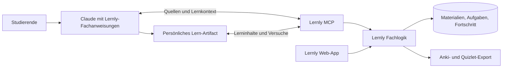

# Lernly mit Claude: technische Entscheidung und Umbauplan

**Überholt durch die zweite Konkretisierung:** Der aktuelle [Architektur- und Kostenplan](/Users/rdb/lernly/docs/strategy/2026-11-13-lernly-architecture-v2.md) erweitert den Einstieg auf Marketing, Mathe/Statistik und Finance, legt den fertigen Trainer in Lernly ab und priorisiert Ordnerzugriff. Außerdem wurde inzwischen ein offizieller Quizlet-Connector für Claude verifiziert. Dieser erste Entwurf bleibt als frühere Untersuchung erhalten; für Umfang, Integrationen, Preise und Reihenfolge gilt der neue Plan.

Stand: 13. November 2026. Entscheidungsentwurf auf Basis des lokalen Repositories, der aktuellen Herstellerdokumentation und Daniels verlinktem Artifact. Die App wurde für diese Untersuchung nicht verändert. Produktionsdaten, Abrechnung und ein echter MCP-Durchlauf wurden nicht geprüft. Aufwand, Preise und Erfolgsschwellen sind Planungshypothesen.

**Empfehlung.** Lernly zu einer dauerhaften Lernzentrale für zunächst einen konkreten Corporate-Finance-Kurs entwickeln. Claude übernimmt das persönliche Erklären und Gestalten von Lern-Artifacts. Ein Lernly-Plugin bündelt Fachanweisungen und die Verbindung zur Lernly-Datenbasis. Lernly verantwortet Quellen, geprüfte Aufgabentypen, gespeicherte Versuche und die nächste sinnvolle Übung. Die bestehende App bleibt als geräteübergreifender Zugang und für Übungen verfügbar. Zuerst einen vollständigen Lerndurchlauf beweisen, danach den Umbau ausweiten.

Die technische Machbarkeit ist gut. Die Zahlungsbereitschaft für Lernly zusätzlich zu Claude ist offen. Ein größerer Connector-Katalog beantwortet diese wirtschaftliche Frage noch nicht.

**Was das konkrete Artifact zeigt.** Im [CF Study OS](https://claude.ai/artifact/EbKXQ41UYHRo5aZPAzZEDF) sind Exam Track, Mocks, Dashboard, Topics, Memorize und Cheat Sheet sichtbar. Die Oberfläche nennt 13 Themen und 54 Aufgaben. Der DCF-Bereich verbindet Erklärung, Musterlösung, Quellenhinweise und typische Fehler mit Rechenaufgaben; Varianten bieten neue Zahlen und Eingabefelder mit Rundungstoleranz. Das Dashboard priorisiert nach erwarteten Klausurpunkten und verbleibenden Schwächen. Es erklärt, dass Fortschritt in diesem Browser gespeichert wird. Untersucht wurden die sichtbaren Abläufe, nicht der Quellcode, sämtliche Lösungen oder die zugrunde liegenden Vorlesungsdateien.

Das Produktziel sollte deshalb lauten: Diesen persönlich passenden Lernablauf ohne langes Vorbereiten für einen neuen Kurs reproduzierbar machen und über mehrere Lernwochen zuverlässig fortsetzen. Ein Dashboard allein wäre gegenüber dem Beispiel ein zu kleiner Fortschritt. Claude bietet inzwischen selbst persistente Artifact-Daten; auch Speicherung allein ist keine tragfähige Differenzierung. [Claude: Artifacts](https://support.claude.com/en/articles/17153992-what-are-artifacts-and-how-do-i-use-them)

**Die technische Grenze beim Claude-Abo.** Drei Wege müssen getrennt bleiben:

| Weg | Kosten und Zugang | Bewertung für Lernly |
|---|---|---|
| Nutzer arbeitet in Claude; Claude greift auf Lernly zu | Claude-Nutzung innerhalb des Nutzerplans; Lernly betreibt seine Daten- und Werkzeugdienste | Empfohlener Start |
| Ein bei Claude laufendes Artifact verwendet Claude und Lernly | Artifact-Modellnutzung zählt laut Anthropic gegen den Plan des jeweiligen Nutzers; Connector-Verfügbarkeit beachten | Passend zum bestehenden Lernverhalten |
| Lernly-Webseite ruft im Hintergrund Claude auf | Regulärer API-Zugang, bezahlt durch Lernly oder einen separaten API-Key des Nutzers | Spätere optionale Komfortvariante |

Anthropic erlaubt Drittentwicklern ohne gesonderte Freigabe nicht, Claude-Login beziehungsweise die Nutzungslimits der Claude-Abos als Zugang für eigene Produkte anzubieten. Ein MCP-Connector ändert das nicht. Beim vorgesehenen Connector-Weg meldet sich Claude bei Lernly an; Lernly erhält dadurch keinen Zugang zum Claude-Abo. [Agent SDK: Authentifizierung](https://code.claude.com/docs/en/agent-sdk/quickstart)

Ein bei Claude ausgeführtes Artifact kann dagegen offiziell Claude-Funktionen auf dem Plan seines jeweiligen Nutzers verwenden. Verbundene Apps können Artifacts auf bezahlten Plänen im Web und auf Desktop lesen und beschreiben. Jeder Nutzer verbindet seine eigenen Konten. Tools, die für jede einzelne Aktion eine erneute Freigabe benötigen, stehen Artifacts nicht zur Verfügung. Das beeinflusst den Zuschnitt der Fortschritts-Tools. [Claude: Artifacts und verbundene Apps](https://support.claude.com/en/articles/17153992-what-are-artifacts-and-how-do-i-use-them)

Custom Connectors gibt es auch im Free-Plan, dort begrenzt auf einen. Daraus folgt keine Free-Verfügbarkeit des gesamten Artifact-Lernablaufs. Für den ersten Pilot würde ich Nutzer mit einem passenden bezahlten Claude-Plan und Web/Desktop auswählen. [Claude: Custom Connectors](https://support.claude.com/en/articles/11175166-get-started-with-custom-connectors-using-remote-mcp)

**Warum die bestehende App anders lernt.** Die sichtbare Implementierung ist auf das Erzeugen eines begrenzten Lernpakets ausgelegt. Daniels Claude-Workflow hat viel mehr Freiheit bei Materialzugriff, Interaktion und Darstellung. Die folgenden Befunde erklären mögliche Qualitätsunterschiede; sie ersetzen keinen Vergleich mit identischem Material und identischen Modellbedingungen.

| Befund im Repository | Bedeutung für den Umbau |
|---|---|
| [taskModels.ts](/Users/rdb/lernly/src/lib/taskModels.ts:3): Sonnet 4.6 für anspruchsvollere Inhalte, Haiku 4.5 für Karten und Metadaten | Die vorhandene App nutzt bereits Claude. Ein Connector allein verbessert weder Modell noch Didaktik. |
| [examTasks.ts](/Users/rdb/lernly/src/lib/examTasks.ts:22): vier aktive Generierungsaufgaben; [generatePack.ts](/Users/rdb/lernly/src/lib/generatePack.ts:802) ergänzt optional Analyse | Die Kosten entstehen durch mehrere Generierungsschritte. Prompt-Caching ist bereits implementiert; pauschal fehlendes Caching wäre eine falsche Diagnose. |
| [generatePack.ts](/Users/rdb/lernly/src/lib/generatePack.ts:227): Thinking in diesem Aufruf deaktiviert; feste Ausgabegrenzen und Schemas | Das ist eine andere Konfiguration als ein frei iterierter persönlicher Claude-Chat. Der genaue Qualitätsanteil muss gemessen werden. |
| [tutorPrompt.ts](/Users/rdb/lernly/src/lib/tutorPrompt.ts:1): aktuelles Konzept, drei Gesprächsrunden, 500 Ausgabetokens | Für flexible Erklärungen über mehrere Vorlesungen fehlt dem Tutor Kontext. |
| [generate/route.ts](/Users/rdb/lernly/src/app/api/generate/route.ts:830): normale Storage-Uploads werden nach Verarbeitung entfernt | Eine dauerhafte Quellenbibliothek fehlt in diesem Ablauf. Bereits gelöschte Originale lassen sich aus den Lernpaketen nicht wiederherstellen. |
| [textExtract.ts](/Users/rdb/lernly/src/lib/textExtract.ts:28): PDF-Text wird seitenübergreifend zusammengeführt | Seitenbezüge müssen bei der neuen Materialverarbeitung erhalten bleiben. Formeln und Abbildungen brauchen zusätzlich einen visuellen Zugriff. |
| [schema.ts](/Users/rdb/lernly/src/lib/schema.ts:345) und [PackView.tsx](/Users/rdb/lernly/src/components/pack/PackView.tsx:1): feste Pack-Struktur und vorgegebene Ansichten | LaTeX, Karten und Quiz sind vorhanden; beliebige fachspezifische Rechentrainer sind ein zusätzlicher Produkttyp. |
| [studentProgress.ts](/Users/rdb/lernly/src/lib/dashboard/studentProgress.ts:31) und [srs.ts](/Users/rdb/lernly/src/lib/srs.ts:17): Fortschritt aus eigenen Karten und Quizversuchen; Mastery anhand Wiederholungsintervall | Externe Versuche benötigen eigene Herkunft, stabile IDs und eine gemeinsame Auswertung. Die bisherige Mastery ist keine validierte Klausurprognose. |
| [generatePack.ts](/Users/rdb/lernly/src/lib/generatePack.ts:165): Quizlet-Exporttext wird abgeleitet | Eine Grundlage für Textexport existiert. Im untersuchten Code ist keine echte Quizlet-/Anki-Synchronisierung erkennbar. |
| [settings/page.tsx](/Users/rdb/lernly/src/app/dashboard/settings/page.tsx:149): BYOK-Oberfläche standardmäßig pausiert, Endpunkte vorhanden | BYOK verwendet einen Anthropic-API-Key und separate API-Abrechnung; es verbindet kein Claude-Abo. |
| [features.ts](/Users/rdb/lernly/src/lib/features.ts:8): Cram deaktiviert | Projektbeschreibungen sind teilweise älter als der Code. Ein großer Materialimport darf nicht einfach als bereits verfügbar vorausgesetzt werden. |
| [hochschulen/page.tsx](/Users/rdb/lernly/src/app/hochschulen/page.tsx:44), [LeadForm.tsx](/Users/rdb/lernly/src/app/hochschulen/LeadForm.tsx:28) | Das sichtbare B2B-Angebot besteht im Wesentlichen aus Landingpage, Pilotangebot, Kontaktstrecke und Beispielreports. Eine separate Hochschul-App mit institutionellen Rollen, Kohorten und Freigaben ist im untersuchten Schema nicht erkennbar. |

Eine eigene API-App könnte mit denselben Kontexten, passenden Modellen und guten Werkzeugen ebenfalls hochwertige Ergebnisse liefern. Die Vorteile der Claude-Variante liegen vor allem im vorhandenen Nutzerworkflow und darin, dass Lernly weniger individuelle Modellnutzung finanzieren muss. Das Modellproblem wird nicht durch das Protokoll gelöst.

**Welches Produkt ich zuerst bauen würde.** Ein persönlicher Klausurtrainer für Corporate Finance und Valuation, aufgebaut aus den tatsächlichen Unterlagen eines Kurses. BWL-Studierende mit Finance-Interesse sind eine sinnvolle erste Zielgruppe. IB-, PE- und Consulting-Interviewvorbereitung würde ich als eigene spätere Anwendungsfälle behandeln, weil Prüfungsstoff, Übungsform und Erfolgskriterium auseinandergehen.

Der erste Ablauf:

1. Nutzer legt eine Klausur mit Datum, Zeitbudget, Sprache und vorhandenen Unterlagen an.
2. Lernly speichert Material einmalig, zeigt den Verarbeitungsstand und hält Kapitel sowie Quellen auffindbar.
3. Nutzer verbindet Lernly mit Claude und installiert die zugehörigen Fachanweisungen.
4. Claude erhält einen kompakten Lernkontext und liest gezielt relevante Quellen nach.
5. Claude erstellt beziehungsweise verbessert den persönlichen Trainer. Lernly speichert dessen strukturierte Lerninhalte mit IDs und Quellen.
6. Nutzer löst Aufgaben im Artifact oder in Lernly. Ein klar begrenztes Werkzeug speichert tatsächliche Versuche.
7. Lernly berechnet daraus die nächste Wiederholung und den Tagesplan. Im nächsten Claude-Chat ist dieser Stand wieder abrufbar.
8. Ausgewählte Karten lassen sich zu Anki oder Quizlet exportieren. Exportierte Karten gelten noch nicht als gelernt.

Im Dashboard wäre die Hauptaktion beispielsweise: „Heute: Terminal Value ohne Hilfe rechnen, zwei frühere Fehler wiederholen, danach ein kurzer Klausurblock.“ Eine Materialbibliothek und die nächste konkrete Übung stehen vor einer Sammlung generierter Pakete.

**Aufteilung zwischen Lernly, Claude und Artifact.** Ein Plugin kann Skills und einen Remote-MCP-Connector zusammen bündeln. Skills enthalten die Lernmethodik und das gewünschte Ergebnis; der Connector liefert Daten und führt erlaubte Aktionen aus. Diese Trennung ist auch in Anthropics Produktmodell vorgesehen. [Claude: Plugin-Bausteine](https://claude.com/docs/connectors/building/what-to-build)

Die Pfeile beschreiben die vorgeschlagene Architektur. Der Artifact-Rückkanal muss im echten Claude-Client erprobt werden. Lernly kann nicht allein durch MCP automatisch alle alten Chats, Artifacts oder lokalen Ordner eines Nutzers auslesen. Ein Remote-Connector gibt Claude Zugriff auf den vom Lernly-Server angebotenen Datenbestand. Lokale Dateien brauchen einen gesonderten, vom Nutzer eingerichteten Zugriff oder einen Import. Remote-Verbindungen kommen von Anthropics Infrastruktur. [Claude: Netzwerk und Connector-Zugriff](https://support.claude.com/en/articles/11175166-get-started-with-custom-connectors-using-remote-mcp)

Für den MVP ist ein einmaliger Mehrdatei-Upload ausreichend. Ordnersynchronisierung oder Google Drive sind spätere Integrationen. Die Dateisuche darf nicht jedes Mal sämtliche Vorlesungen als riesigen Tool-Output zurückgeben: Inhaltsverzeichnis und Suche zuerst, passende Seiten danach. Für Vollständigkeit zusätzlich eine Abdeckungsübersicht führen; reine Suchtreffer beweisen nicht, dass das gesamte Modul berücksichtigt wurde.

Ein Skill kann ein Lernformat anleiten, aber keinen fehlerfreien Output erzwingen. Format, Eigentümerschaft, IDs und numerische Ergebnisse werden auf Lernly-Seite geprüft. Die Fachanweisungen enthalten insbesondere Quellenpflicht, variable Erklärungsstufen, typische Fehlkonzepte, Aufgabenvariation und Regeln für das Speichern von Versuchen. Originalaufgabe, vereinfachtes Beispiel und neu erzeugte Variante müssen unterscheidbar sein.

**Der größte Kostenhebel: einmal bauen, oft üben.** Bei einem geprüften DCF-Aufgabentyp braucht jede neue Zahlenvariante keinen neuen Modellaufruf. Ein begrenzter Generator zieht zulässige Parameter; normaler Code berechnet Lösung und Zwischenschritte und bewertet die Eingabe mit definierten Toleranzen. Claude hilft beim Erstellen und Erklären des Aufgabentyps und bei individuellen Rückfragen.

Für den ersten Trainer genügen wenige fachlich sauber geprüfte Varianten. Gespeichert werden Aufgabentyp, Generatorversion, Parameter, Antwort, genutzte Hilfen und Bewertung. Dadurch ist ein Versuch später exakt rekonstruierbar. Grenzfälle, Rundung und zulässige Parameterbereiche gehören zur fachlichen Prüfung. Modellgenerierter beliebiger Code wird dafür nicht ungeprüft auf dem Lernly-Server ausgeführt.

Dieser Ansatz passt auch zur eigenen Web-App: Eine vorbereitete Übungsrunde läuft ohne Modellkosten, selbst wenn Claude gerade ein Nutzungslimit erreicht. Für freie Erklärungen bleibt Claude zuständig. Für neue Fächer muss fachlich geprüft werden, welche Übungen sich auf diese Weise abbilden lassen.

**Artifacts und MCP Apps erfüllen verschiedene Aufgaben.** Im ersten Pilot würde ich Daniels frei gestaltbare Artifacts erhalten. Für dauerhaft zuverlässige Eingaben, Formeltrainer und Quellenanzeigen kann später eine von uns gebaute MCP App sinnvoll sein. Sie zeigt eine kontrollierte Lernly-Oberfläche innerhalb der Claude-Unterhaltung. Das ist eine andere Oberfläche als ein bei jedem Durchlauf neu generiertes Artifact. [Claude: MCP Apps](https://claude.com/docs/connectors/building/mcp-apps/getting-started)

Darüber können Teile bestehender React-Komponenten wiederverwendet werden, nachdem ihre Bindung an Next.js-Server-Actions gelöst wurde. Ein eingebettetes Lernly-Dashboard ist eine zusätzliche Möglichkeit, jedoch keine voraussetzungslose Abkürzung: Bestimmte Fähigkeiten und Verzeichniseinträge verlangen gesonderte Freischaltungen beziehungsweise einen Verified-Status. Der MVP sollte davon unabhängig funktionieren. [Claude: eingebettete Websites](https://claude.com/docs/connectors/building/mcp-apps/embedded-sites)

**Konkrete Änderungen im Repository.** Next.js, Supabase und die vorhandene App bleiben die Basis. Der Umbau erfolgt über zusätzliche Datenstrukturen und eine gemeinsame Fachlogik, die sowohl Web-App als auch MCP benutzen.

| Bereich | Wiederverwenden | Ergänzen beziehungsweise ändern |
|---|---|---|
| Konten | Supabase Auth und bestehende Nutzer | OAuth-Zustimmung für Claude, Verbindung widerrufen, begrenzte Zugriffsrechte |
| Klausuren | exams, Termine und Erinnerungen | Materialübersicht, Lernpräferenzen, fachliche Themenstruktur; zunächst keine zusätzliche komplexe Kursverwaltung |
| Dateien | Upload-Validierung, privater Storage, PDF-Hilfen | Eigener langlebiger Materialbestand, Versionen, Seitenbezüge, Verarbeitungsschlange |
| Inhalte | Zod-Validierung, Math-Rendering, Teile der Karten-/Quizansichten | Stabile Lernobjekte, numerische Aufgaben und generatorgestützte Varianten |
| Lernstand | Vorhandene Reviews, Quizhistorie und Dashboard-Komponenten | Ereignisse aus verschiedenen Quellen, nachvollziehbare Auswertung und Tagesplan |
| Generierung | Vorhandene API-Pipeline bleibt für bestehende Pakete | Neuer Importweg für von Claude gelieferte Inhalte; keine Paketgenerierung beim bloßen Quellenabruf |
| Abrechnung | Stripe-Bestand und existierende Ansprüche | Neuer Connector-Tarif erst nach Pilot; alte Käufe und Credits weiterhin erfüllen |
| Integrationen | Bereits abgeleiteter Quizlet-Text | Exportoberfläche, sauberes Anki-Format, später getrennte Synchronisationsdienste |

Vorgeschlagene neue Bereiche, noch keine existierende Implementierung:

- /Users/rdb/lernly/src/lib/materials/: Import, seitenbezogene Extraktion, Suche und Quellenzugriff.
- /Users/rdb/lernly/src/lib/learning/: Inhaltsverträge, Aufgabengeneratoren, Sitzungen, Versuche und Lernplanung.
- /Users/rdb/lernly/src/lib/mcp/: Server, Authentifizierung und schmale Werkzeugadapter.
- /Users/rdb/lernly/src/app/api/mcp/route.ts: öffentlicher, authentifizierter MCP-Endpunkt.
- /Users/rdb/lernly/src/app/oauth/consent/page.tsx: Zustimmung zu Lernly-Zugriffen.
- /Users/rdb/lernly/plugins/lernly/: Plugin-Manifest, Remote-Connector-Verweis und Fach-Skill.

Die aktuelle Next.js-Version ist 16.2.4. Die lokale Route-Handler-Dokumentation wurde gelesen. Der Endpunkt sollte zunächst im bestehenden Node-Backend als zustandsloser Streamable-HTTP-Dienst umgesetzt werden, wenn der ausgewählte SDK-Adapter dort verifiziert funktioniert. Sitzungen und Jobs gehören in persistente Datenhaltung, nicht in eine flüchtige Prozessvariable. Längere Importarbeiten werden als Jobs gestartet und abgefragt. Claude empfiehlt Streamable HTTP; Sampling ist im dokumentierten Claude-MCP-Client nicht unterstützt. Lernly kann also nicht über einen MCP-Hintergrundjob beliebig Modellarbeit auf dem Nutzerabo anfordern. [Claude: MCP-Server bauen](https://claude.com/docs/connectors/building)

**Datenmodell in überschaubaren Schritten.** Die bestehende exams-Entität kann im Pilot als Kurs-/Klausurcontainer dienen. Die folgenden logischen Entitäten werden schrittweise ergänzt; sie sind noch kein fertiges Migrationsskript.

| Entität | Wesentliche Daten |
|---|---|
| materials | Besitzer, Klausur, Originaldatei, Hash/Version, Titel, Verarbeitung und Löschstatus |
| material_chunks | Materialversion, Seite/Position, Text, Verweis auf visuelle Darstellung, Extraktionsqualität |
| learning_topics | Stabile Themen-ID je Klausur, Voraussetzungen, belegt bekannte Klausurrelevanz |
| learning_items | Stabile UUID, Thema, Inhaltstyp, Version, Quellen, Musterlösung/Rubrik oder Generatorreferenz |
| study_sessions | Nutzer, Klausur, verwendete Item-Versionen, Oberfläche, Beginn und Abschluss |
| learning_events | Unveränderlicher Versuch, eindeutige Ereignis-ID, Antwort, Hilfen, Bewertung, Herkunft, Zeit |
| study_plans | Klausurtermin, verfügbares Zeitbudget, abgeleitete nächste Aufgaben, Planversion |
| connector_grants | Verbindung, erlaubte Klausuren und Aktionen, Widerruf |

Lernfortschritt referenziert stabile IDs statt frei geschriebener Themennamen. Bei einer Inhaltsänderung bleibt nachvollziehbar, auf welcher Version ein früherer Versuch beruhte. Neue Inhalte können weiterhin JSONB-Felder nutzen; kein Anlass, jeden Textbaustein sofort in eigene Tabellen zu zerlegen.

Alte Lernpakete bleiben lesbar. Ihre vorhandenen Karten-IDs sind nur innerhalb eines Pakets eindeutig; ein Migrationsadapter muss diesen Namensraum erhalten. Bestehende Review-Zustände und aggregierte Quizversuche dürfen übernommen, fehlende einzelne Antworten oder Quellen aber nicht nachträglich erfunden werden. Neue Materialien erhalten einen eigenen Speicherpfad oder Bucket, damit die bisherige Upload-Bereinigung sie nicht versehentlich löscht.

**Ein kleiner Werkzeugumfang reicht.** Dies sind vorgeschlagene Lernly-Werkzeuge, keine Anthropic-API-Namen:

| Werkzeug | Zweck |
|---|---|
| list_exams | Freigegebene Klausuren finden |
| get_study_context | Lernziel, Präferenzen, Themen, Schwächen und Materialübersicht laden |
| search_materials | Relevante Quellenstellen innerhalb einer Klausur finden |
| read_material | Begrenzte Seiten/Abschnitte und bei Bedarf visuelle Inhalte lesen |
| save_learning_items | Generierte Aufgaben und Karten schema-validiert speichern; stabile IDs zurückgeben |
| start_study_session | Einen Versuchsdurchlauf mit konkreten Aufgabenversionen anlegen |
| record_attempts | Tatsächliche Antworten gesammelt und ohne Doppelzählung speichern |
| get_study_plan | Aus Lernstand und Zeitbudget nächste Aufgaben ableiten |
| export_flashcards | Gewählte Karten im passenden Exportformat liefern |

Für den ersten Machbarkeitstest reicht eine Teilmenge mit einer fest ausgewählten Testklausur. get_study_context liefert auch die Inhaltsvertragsversion. Fehler werden verständlich und strukturiert zurückgegeben, damit Claude Eingaben korrigieren kann. Eigentümerschaft wird aus der geprüften Anmeldung abgeleitet, niemals aus einer vom Modell frei gelieferten user_id.

**Anmeldung und Rückkanal sind die entscheidenden Integrationsarbeiten.** Bestehende Browser-Cookies können nicht einfach für Remote-MCP-Aufrufe verwendet werden. Supabase bietet inzwischen einen OAuth-2.1-Server mit MCP-Unterstützung; das ist der erste zu prüfende Weg für die vorhandenen Konten. Ob die Funktion im konkreten Projekt aktiv ist und die installierten SDKs ausreichen, wurde nicht geprüft. [Supabase: OAuth-Server](https://supabase.com/docs/guides/auth/oauth-server), [Supabase: MCP-Authentifizierung](https://supabase.com/docs/guides/auth/oauth-server/mcp-authentication)

Der Aufbau umfasst eine Lernly-Zustimmungsseite, Tokenprüfung und Refresh, die erforderlichen Metadaten und einen Widerruf. Claude erwartet unter anderem PKCE und korrekt erreichbare Discovery-Endpunkte. Diese Umsetzung wird gegen den realen Claude-Client getestet. [Claude: Connector-Authentifizierung](https://claude.com/docs/connectors/building/authentication)

Die bestehenden RLS-Regeln begrenzen vieles auf den eigenen Nutzer. Für einen Connector kann das dennoch zu breit sein: Eine Zustimmung zu einem Kurs soll nicht sämtliche Materialien, Kontodaten oder vorhandene Secrets freigeben. Berechtigungen müssen deshalb auch für direkte Datenzugriffe und anhand des OAuth-Clients greifen. Supabase dokumentiert dafür client_id-bezogene RLS und Token-Claims. Frei erfundene OAuth-Scopes ersetzen diese Durchsetzung nicht. [Supabase: Token Security und RLS](https://supabase.com/docs/guides/auth/oauth-server/token-security)

Fortschritts-Tools dürfen nach bewusster Verbindung begrenzte Versuche für eigene Sitzungen schreiben. Sie brauchen keine generischen Lösch-, SQL-, Kontoverwaltungs- oder Abrechnungsrechte. Wiederholte Übertragung desselben Ereignisses zählt einmal. Bei Verbindungsabbruch zeigt die Oberfläche den ungespeicherten Zustand und bietet einen erneuten Versuch. Das Konto und der Sitzungsschlüssel müssen zusammenpassen.

Für bekannte numerische Aufgaben erfolgt die Bewertung auf dem Server gegen die gespeicherten Parameter. Eine von Claude übermittelte Selbsteinschätzung oder Freitextbewertung wird als solche gespeichert. Ein frei generiertes Artifact ist kein vertrauenswürdiger Prüfer. Die Anwendung ist ein Lernwerkzeug; sie soll aus diesen Daten keine unbelegte Sicherheit über die echte Klausurnote ableiten.

**Wie Fortschritt sinnvoller wird.** Gelesene Theorie, Selbstbewertung, richtige Antwort mit Hilfen und eigenständig gelöste neue Aufgabe sind unterschiedliche Signale. Wiederholtes Öffnen einer Musterlösung erhöht keine nachgewiesene Beherrschung. Der Tagesplan kann zunächst aus Klausurnähe, Fälligkeit, bisherigen Fehlern und verfügbarem Zeitbudget regelbasiert entstehen. Ein neues LLM-Ergebnis für jedes Öffnen des Dashboards ist unnötig.

Die Punkteanzeige im Referenz-Artifact ist als motivierende Lernschätzung interessant. Für Lernly würde ich belegte Klausurgewichtung und tatsächlich gelöste Aufgaben getrennt anzeigen. „In vorhandenen Altklausuren gefunden“ braucht konkrete Referenzen; „kommt sicher dran“ wäre daraus keine belastbare Folgerung. Fachliche Qualität wird mit zurückgehaltenen Aufgaben überprüft, die nicht identisch mit den vorher trainierten Beispielen sind.

**Anki und Quizlet realistisch anbinden.** Korrektur nach weiterer Recherche: Quizlet bietet einen offiziellen Claude-Connector für die Erstellung von Sets. Er wird im neuen Plan direkt berücksichtigt; Export bleibt ein Fallback. Ein vollständiger Fortschrittsrückkanal ist dadurch noch nicht belegt. [Offizieller Quizlet-Connector](https://claude.com/marketplace/connectors/quizlet). Anki unterstützt Textimporte mit getrennten Feldern; Quizlet bietet einen dokumentierten Import von Begriff-/Definitionspaaren. [Anki: Textimport](https://docs.ankiweb.net/manual/importing/text-files), [Quizlet: Inhalte importieren](https://help.quizlet.com/hc/en-us/articles/360029977151-Creating-sets-by-importing-content)

Für Anki: UTF-8-Export, stabile externe Kennung, Tags und getestete Darstellung mathematischer Inhalte. Später ein Deck-Paket für mehr Komfort. Für Quizlet: eigener einfacher Textadapter; nicht voraussetzen, dass LaTeX oder HTML identisch gerendert werden. Die vorhandene quizletExport-Ableitung ist ein Startpunkt, ersetzt aber keine Importprüfung.

Eine aktuelle, öffentlich dokumentierte Quizlet-Schnittstelle für den benötigten vollständigen Schreib- und Fortschrittszugriff konnte ich in den geprüften offiziellen Quellen nicht verifizieren. Deshalb kein Versprechen von automatischer Zwei-Wege-Synchronisierung. Falls Nutzer diese Funktion benötigen, muss zuerst ein belastbarer API-/Partnerzugang geklärt werden.

AnkiConnect ist ein möglicher späterer Weg. Die einsehbare Primärimplementierung verwendet standardmäßig einen lokalen Dienst und enthält Zugriffe auf Review-Historie. Ein entfernter Lernly-Server erreicht diesen nicht automatisch. [AnkiConnect: Konfiguration](https://raw.githubusercontent.com/FooSoft/anki-connect/master/plugin/config.json), [AnkiConnect: Implementierung](https://raw.githubusercontent.com/FooSoft/anki-connect/master/plugin/__init__.py)

Für eine Produktintegration wären ein lokales Add-on oder eine lokale Brücke sowie eine aktuelle Kompatibilitätsprüfung erforderlich. Das ursprüngliche GitHub-Projekt verweist inzwischen auf einen anderen Repository-Host; die gelesene Implementierung ist kein Nachweis der neuesten Release-Kompatibilität. [AnkiConnect: Projektverweis](https://github.com/FooSoft/anki-connect)

Bei späterem Sync ordnet Lernly eigene IDs den Anki-Notizen, Karten und Reviews zu. Importierte Review-Ereignisse werden dedupliziert. Für ein in Anki gelerntes Deck bleibt Anki für dessen Wiederholungsplan verantwortlich; Lernly wertet die Informationen aus, statt konkurrierend Fälligkeiten zu überschreiben. Nach einem reinen Export zeigt Lernly den externen Lernstand als unbekannt an.

**B2C und Hochschulen getrennt priorisieren.** Die erste Validierung sollte B2C betreffen: Daniel und eine kleine Gruppe mit ähnlichen Kursen und vorhandenem Claude-Zugang. Das verkürzt den Weg zum echten Gebrauch. Die Hochschul-Landingpage muss dafür nicht gelöscht werden.

Ein späteres B2B-Produkt braucht zusätzlich institutionelle Zugriffe, Freigaben, Rollen, Berichte und eine geeignete Vertrags-/Betriebskonfiguration. Private Claude-Abos aller Studierenden sind dafür keine voraussetzungslose Architektur. Auch Aussagen der bisherigen Hochschulseite über API-Verarbeitung dürfen nicht automatisch auf individuelle Consumer-Konten übertragen werden. Bei einem konkreten Hochschulpartner würde ich zwischen institutionellem Claude-Zugang und von Lernly finanziertem API-Betrieb entscheiden. Das ist eine eigene Produktentscheidung.

**Aufwand und Reihenfolge.** Grobe Schätzung: vier bis acht Kalenderwochen für eine brauchbare geschlossene Beta, bei einem erfahrenen Entwickler mit konzentrierter Arbeitszeit und laufender fachlicher Mitarbeit. Das beinhaltet keine Garantie für Directory-Freigaben, keinen vollständigen Anki-Sync und keinen Hochschul-Rollout. Der technische Test kommt vor der großen Umstrukturierung.

| Schritt | Aufwandshypothese | Ergebnis und Abnahme |
|---|---|---|
| 0. Referenz und technischer Durchlauf | 2–4 Arbeitstage | Ein ausgewähltes Kapitel wird aus Lernly in Claude gelesen; ein Trainer schreibt einen tatsächlichen Versuch zurück; nach neuem Chat/Browser ist der richtige Stand wieder verfügbar. Zwei Nutzer bleiben strikt getrennt. |
| 1. Dauerhafte Quellen und erste Aufgaben | 4–7 Arbeitstage | Eigener Materialbestand mit Seitenbezügen; ein fachlich geprüfter DCF-Generator und strukturierte Lerninhalte; keine Auswirkungen auf alte Uploads und Pakete. |
| 2. Wiederholbarer Lernablauf | 5–8 Arbeitstage | Fach-Skill, robuste Sitzungen und Ereignisse, Tagesplan; Fehlerfälle wie doppelte Übertragung, falsche Quellenzuordnung und Verbindungsabbruch sind abgefangen. |
| 3. Onboarding und Export | 3–5 Arbeitstage | Verbindung ohne Entwicklerhilfe, verständliche Grenzen der unterstützten Claude-Pläne, funktionierender Kartenexport, nutzbares Web-Dashboard. |
| 4. Nutzungspilot | Etwa 2 Wochen, teilweise überlappend | Daniel plus ungefähr zehn passende Studierende nutzen eigene Unterlagen mehrfach. Danach Entscheidung über Ausbau und Preis. |

Im technischen Test werden insbesondere erneute Anmeldung, ablaufende beziehungsweise widerrufene Zugriffe, Artifact-Toolfreigabe und geräteübergreifendes Weiterlernen beobachtet. Mobile wird erst nach einem eigenen erfolgreichen Durchlauf zugesagt. Falls der Rückkanal im frei generierten Artifact unzuverlässig bleibt, wird die Bewertung in einer kontrollierten Lernly-Ansicht beziehungsweise MCP App durchgeführt. Dieser Rückfallweg muss ausprobiert werden, bevor das Produkt automatisches Tracking verspricht.

Mögliche kleine Implementierungspakete nach positivem Test:

1. Materialbibliothek mit eigenen Speicherpfaden und additiven Tabellen.
2. Gemeinsame Lernlogik und stabile Inhalts-/Versuchsverträge.
3. OAuth und MCP mit Lesezugriff sowie begrenztem Schreiben von Versuchen.
4. Corporate-Finance-Skill, geprüfte Rechenvarianten und Export.
5. Dashboard und Onboarding für den neuen Ablauf hinter einem Feature-Schalter.

Die Projektregeln in [CLAUDE.md](/Users/rdb/lernly/CLAUDE.md) nennen eine zwischen Preview und Produktion geteilte Datenbank. Für den Pilot daher eine wirklich getrennte Testdatenbank verwenden. Ein Preview-Deployment allein isoliert keine Nutzerdaten. Produktionsmigrationen, Auth-/Billing-Änderungen und Veröffentlichung erfolgen erst im jeweils vorgesehenen Review; dieser Plan führt keine davon aus. Alte Tarifansprüche bleiben erhalten. Eine spätere Bereinigung alter Tabellen oder Endpunkte ist ein eigener Schritt nach erfolgreicher Einführung.

**Woran wir entscheiden, ob es ein Geschäft wird.** Der relevante Vergleich ist Daniels heutiger guter Claude-Workflow mit denselben Materialien. Eine schwache Standardantwort als Vergleich wäre wenig aussagekräftig. Gemessen werden Zeit bis zum ersten brauchbaren Trainer, fachliche Fehler, eigenständig gelöste neue Aufgaben, erneute Nutzung nach mehreren Tagen, Supportaufwand und tatsächliche Zahlungsbereitschaft.

Als vorläufige Entscheidungsschwellen für ungefähr zehn Pilotnutzer: mindestens sechs bevorzugen den verbundenen Ablauf nach mehreren Sitzungen; mindestens fünf lernen an drei verschiedenen Tagen; mindestens drei wollen zu einem konkret getesteten Preis weiterzahlen. Das sind interne Kriterien zur Fokussierung, keine statistisch belastbare Marktstudie. Wenn Nutzer nur einmal ein Artifact erzeugen und danach keinen Lernly-Mehrwert brauchen, spricht das eher für ein einmaliges Setup-Angebot oder ein Fachpaket als für ein dauerhaftes Abo.

Eine mögliche Preishypothese wäre ein kleiner Monatspreis von etwa 5–9 Euro zusätzlich zum separat benötigten Claude-Plan; alternativ ein Klausur-/Semesterpaket testen. Den Preis erst festlegen, wenn wiederholter Nutzen und Supportkosten sichtbar sind. Claude-Nutzung ist weiterhin limitiert. Lernly trägt Hosting, Datenbank, Speicher, Extraktion/OCR, eventuelle eigene Modellaufrufe und Support. Connector-Aufrufe sind keine pauschale Zusage von kostenlosen Gesamtkosten.

Die Kalkulation sollte pro aktivem Lernenden dokumentieren: Dateimenge, Ingestionskosten, Speicher, eigene API-Aufrufe, Zahlungsgebühren und Supportzeit. Für numerische Übungsvarianten wird zusätzlich gemessen, wie viele Durchläufe ohne Modellaufruf funktionieren. Keine scheinpräzise Marge ohne echte Verbrauchsdaten.

**Wie ich den Nutzen vermarkten würde.** Die erste Demo zeigt einen konkreten Lernmoment: Vorlesung und Altklausur hinein, persönlicher Trainer, eine falsch gerechnete Aufgabe, gezielte neue Variante, am nächsten Tag die passende Wiederholung. Die Botschaft könnte sein: „Deine Finance-Unterlagen werden zu einem persönlichen Klausurtrainer – mit Claude und einem Lernplan, der deinen Fortschritt kennt.“ MCP ist die technische Verbindung, kein Nutzenversprechen für Studierende.

Die ersten Videos sollten mit unterschiedlichen Lernenden erproben, ob der Ablauf ohne langes Prompting verständlich und nützlich ist. Erst nach wiederholter Nutzung breiter werben. Die offene Kernfrage ist, ob Lernly die Vorbereitung und das Weiterlernen so weit vereinfacht, dass Menschen es zusätzlich zu Claude behalten wollen.

**Nächster konkreter Schritt.** Einen einzigen DCF-Lerndurchlauf aus dem Referenz-Artifact nachbauen: eigene Quelle laden, fachlich geprüfte Variante lösen, Antwort speichern, nächsten Lernschritt berechnen und in einer neuen Claude-Sitzung fortsetzen. Dieser Durchlauf prüft Produktwert, Authentifizierung, Artifact-Rückkanal und Kostenmechanik gemeinsam. Er liefert die Grundlage für die Entscheidung, wie viel der bestehenden App anschließend umgebaut wird.
